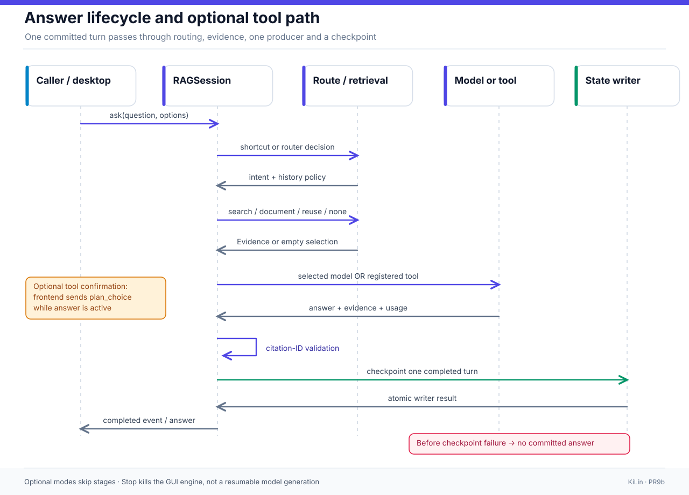

# Answering, routing, tools and conversation lifecycle

## Top-level API and state ownership

`kilin.rag.RAGSession` is the coordinator for one opened project,
retrieval state, live chat/embedding sessions, optional separate router and
one active conversation. The Python entry point for a question is:

```python
import kilin

session = kilin.RAGSession("/path/to/existing/project")
try:
    answer = session.ask("Which module builds the lexical index?")
finally:
    session.close()
```

The path is illustrative; opening a session can load models and may access
the Hugging Face cache/network according to the project's settings. For
reproducible local-only execution set `allow_download = false` in the saved
profile before opening and ensure models are cached.

`RAGSession` owns the authoritative `ConversationTurn` list, selected
conversation path and project/index state. `ChatSession` separately owns the
loaded answering model and in-memory formatted messages; the router may
share that session or be a separate loaded chat model. The optional GUI
adapts callbacks and displays core-owned timelines without maintaining a
separate record. A `ToolContext`
provides scoped operations for registered built-in tools, not arbitrary
filesystem or Python execution.

## One turn, in execution order



*Figure: An ordinary successful turn passes through an optional evidence stage, one answer producer, citation-ID checks and persistence before completion.*

```text
ask(question, options)
   |
   +-- validate settings, mark token usage, start trace/turn
   +-- route_question(): shortcut or router model -> RouteDecision
   +-- resolve intent and related turn IDs / history policy
   +-- select retrieval mode and a search query
   |     +-- search -> ranked chunks and named-file context
   |     +-- document -> selected full document with budget
   |     +-- reuse -> previous evidence
   |     `-- none -> no new evidence
   +-- choose exactly one answer producer
   |     +-- configured built-in tool -> ToolResult
   |     `-- ChatSession.reply() with history + evidence prompt
   +-- validate completion or retain an explicitly incomplete result
   +-- deterministic citation-ID check; collect token usage
   +-- freeze core activity timeline; form ConversationTurn + representation
   +-- persist checkpoint; append committed turn
   `-- notify completed phase (observer)
```

The state machine uses `ANSWER_PHASE_*` identifiers (`routing`, `routed`,
`retrieving`, `evidence_ready`, `memory_retrieving`, `memory_ready`,
`generating`, `saving`, `completed`, and `processing`). Not every intent
performs every phase; tools may control additional progress and confirmation. See [GUI protocol](gui_protocol.md)
for event wire fields and the distinction between backend and frontend
operation states. A callback's failure **before** commitment can abort the
turn; a failure in the final completed notification is traced but should not
recast a successfully committed answer as a failed generation.

### Core answer timelines

`RAGSession.ask()` is the single owner of answer activities. It converts
existing phase notifications into an ordered stream of activity starts,
including intent and conversation-history decisions, retrieval results,
skipped retrieval, detailed tool messages, and generation transitions. It
reports each start through the optional `activity_callback` with an index,
phase, label, and monotonic start offset (`started_ms`). The GUI uses these
labels unchanged; it never derives, suppresses, or renames timeline entries.
The routed activity shows the intent identifier in parentheses after its
readable name, with `using <tool_name>` when the selected intent has a tool.
Repeated notifications for an activity already in progress update that
activity rather than creating artificial duplicate starts.

When conversation memory is enabled for the current answering intent, the
core adds `memory_retrieving` immediately before the index synchronization
and memory query. The following `memory_ready` phase reports both the number
of retrieved **messages** and the number of distinct originating **turns**,
including zero results. The retrieval activity has its own measured duration
in the saved timeline, separate from documentary source retrieval and model
generation. No memory activities appear when memory is disabled, denied by
the intent, or unavailable to a tool-owned answer.

When diagnostic tracing is enabled, those same activity starts appear as
`answer.activity` events, with the identical fields and order.
Tracing is optional: each committed `ConversationTurn.timeline` still stores
an `AnswerTimeline` with `elapsed_ms` and ordered `AnswerTimelineStep`
records (`phase`, `label`, `ms`). The record contains the same activities
reported live and traced, with each span measured by the core monotonic
clock. Durations are non-overlapping and add to the recorded total. This
recording requires neither GUI callbacks nor diagnostic tracing.

The duration measures `ask()` up to the conversation checkpoint. It includes
routing, history selection, retrieval, model or tool execution, and time
waiting for tool confirmation. The `saving` activity begins before the
checkpoint and is retained, but the disk write is excluded from timing.
The post-commit `completed` phase is a status notification, not an activity
in the already-committed turn. Model loading before `ask()` and GUI rendering
are outside the core timeline. No extra model inference or conversation
checkpoint writes are introduced; optional traces receive additional
activity events, with bounded refresh frequency.

For example, notebook code can inspect the committed timeline directly:

```python
answer = session.ask("How is the lexical index built?")
timeline = session.turns[-1].timeline
if timeline is not None:
    print(f"Answer processing: {timeline.elapsed_ms} ms")
    for step in timeline.steps:
        print(step.phase, step.label, step.ms)
```

The timeline is part of the turn in the authoritative checkpoint and follows
that turn when a conversation is branched. An interrupted or uncommitted
answer has no saved timeline. Turns without a timeline remain readable,
but have no recorded activity breakdown. The GUI reads timelines directly
from saved turns and does not maintain a separate timing file or attempt
to reconstruct missing activity data.

## Intent routing and fallback

`answering.route_question()` takes the question, project type and compact
representations of prior turns. First, a configured shortcut pattern can
match without an additional LLM call. Otherwise a router model produces a
structured decision (`RouteDecision`) with intent, standalone/follow-up
judgment and related prior-turn identifiers. Parsed IDs are checked against
available history and additional reference or distinctive-term heuristics;
not every related ID proposed by the model is automatically accepted.
Invalid or unusable router output falls back to the project's default
intent rather than interpreting an arbitrary tool name.

A question with the same distinctive words as an earlier question (case,
word order, punctuation and common words aside) is still routed by the
model. A question that points back ("which dataset did they use?") counts
as a repeat only of the turn just before, where "they" means the same thing;
asked again later, it may mean something else and is routed as new. The prompt adds that it repeats that
turn and how the turn was answered, and, when it is the turn just before,
that the last answer likely missed, so another intent may serve better.
`RouteDecision.repeated_turn` records the turn for tracing. Disliked turns
are never matched. A question asked twice in a row can mean "do it again"
or "that was not what I meant", and only the user knows which. With
`ask(choice_callback=...)`, the user picks **Same way again** (the last
turn's saved intent and related turns, so a repeated inventory stays
consistent) or **Try another way** (the router without the last intent).
Cancelling, or no callback (notebooks), leaves the decision to the router.

Project types currently package several intents for `code` and `literature`:
a mixture of normal answering, named-document reading, source inventory,
mention finding/classification, report generation, related-turn reuse and
small talk. Intent JSON selects retrieval and history behavior, a system
instruction, optional answer guidance, a request-local thinking policy,
and possibly a registered tool.
`project_type._parse_intent()` defaults to `search` for ordinary intents,
`none` for tools if no mode is specified, `hybrid` strategy and `relevant`
history. Always inspect the validated `Intent` record rather than relying
on optional fields being present verbatim in a JSON file.

For source-first ordinary answers, the selected intent also owns
source/passage quotas, hard estimated evidence-token limits and a bounded
versus exhaustive source-coverage policy. Context expansion and related
turns compete for the same final evidence budget. An explicit request for
all sources triggers exhaustive source-coverage reporting; when a source
cannot be represented, a deterministic notice is appended **after** the
model reply. This reports source representation, not full-document review.
Details and example per-intent JSON are in
[Retrieval pipeline](retrieval_pipeline.md#per-intent-source-first-configuration).
Tool-backed intents keep their separately validated tool settings.

`use_router=False` bypasses classification and uses the project's default
intent. A GUI effort selection or router-model choice is not itself an
intent. Router calls have their own token limits and can increase answer
latency; see [Package defaults](package_defaults.md).

## History and follow-up semantics

Saved turns include original question, answer, evidence, timestamp and
parameters. `turn_representation()` constructs a compact summary used when
routing later questions: the question, cited sources and a one-sentence
answer summary. When the router is used, `summarize_answer()` asks the
router model for that sentence once, before the turn is saved, and the
representation records the model under `summary_model`. The answer's
first sentence is kept for one-sentence answers, small talk, incomplete
answers, unrouted turns, and when the summary call fails. Saved summaries
are reused, never regenerated. `refers_back()` identifies follow-up phrasing;
`search_text()` incorporates earlier user wording according to the verified
decision. `select_history()` applies the intent's policy:

- `none`: do not send previous turns to the answering prompt.
- `recent`: send a recent bounded window.
- `relevant`: choose validated related turns where available.

After the router call, two kinds of wording rules from the project type
can change its intent; the router's related turns and standalone
judgement are kept. An intent's `cues` are patterns searched in the
question: the first intent, in the project type's order, whose cue
matches replaces the router's choice ("give me an overview of the Smith
paper" is `paper_overview`, "how does X differ from Y" is
`compare_sources`). Without a cue, the wording can rule out the router's
choice: an intent with `requires` patterns needs one of them to match (a
reference check needs words such as "references" or "cite"), and a tool
that works on an earlier answer (`follows_up`, such as `show_source` or
`filter_results`) is not used when the question names a file and says
nothing of earlier answers ("In Figure 1G of smith20.pdf, what does 79.7
represent?"), since such a question is new and the tool would only report
that it found no earlier answer. The router is then asked once more with
the ruled-out intents left out of the list; when that call fails or still
names one of them, the default intent is used.

Disliked-answer exclusion is controlled by the saved project setting
`history.exclude_disliked_answers` and is enabled by default for every
project type, independently of long-term memory indexing. At the start of
an answer, the core reads project-local feedback for the saved turn UUIDs.
A rejected assistant answer excludes the **complete question/answer pair**
from automatic model context, while leaving the original saved turn intact.
The router never receives the rejected turn's question, summary or sources.
Related-turn numbers are not renumbered; references to rejected turns are
dropped, recent history selects the last eligible turns, and deterministic
fallback skips rejected last turns.

The same eligibility set controls follow-up search wording, source-evidence
reuse and merging, tool `EarlierTurn` records, transitive related-turn links,
and model/tool language context. Reopening a conversation or switching chat
models rebuilds safe history as necessary. Invalid feedback causes an error,
not permissive fallback. Disabling the project policy or resetting Dislike
restores ordinary context behavior; the stored conversation is unchanged.
The feedback store adds only local file reads and no model calls. Details
are in [Conversation memory](conversation_memory.md).

The prompt history contains selected prior **questions and answers**, not
full prior evidence payloads. Related-turn evidence may be carried forward
separately when an intent permits it. This distinction affects privacy,
context size and the interpretation of follow-up answers. The router's
summary is derived from saved turns; it is distinct from the separate,
project-local long-term conversation-memory index.

For an enabled memory policy and an intent allowing `memory.read`, the core
synchronizes eligible saved messages and performs independent memory
retrieval before direct model generation. The previous conversation text
appears under a dedicated `CONVERSATION MEMORY` heading, never within
numbered source `Evidence`. A system-level provenance rule distinguishes
historical assistant assertions from current documentary evidence. Search
hits have separate relevance, preference weights and an independent token
budget. Completed turns retain only the resulting navigation identities
under `parameters.memory_references` (memory labels, UUID/role, and active
conversation/one-based turn origins); source `Evidence` remains separate.
When no memory hits are supplied, the original answer prompt is
unchanged **for ordinary requests**. For explicit conversation-history
questions (such as *"Did we discuss optical tweezers?"*), the core selects a
non-tool, memory-reading default intent when the routed intent cannot read
memory, and skips documentary retrieval. It checks eligible indexed saved
messages lexically, including recent turns that already appear in chat
context, without another model call. A matching question establishes that
the topic was raised, not that its answer was accepted. When there is no
match the model is instructed to report uncertainty, not to claim the topic
was never discussed. Historical lookup remains subject to project and intent
memory policies. Eligible question/answer pairs stay adjacent within the
memory hit and text budgets, so matching questions cannot fill the result
list while crowding out all corresponding saved replies. Tool-owned answer
generation does not receive blended
memory or source passages. See [Conversation memory](conversation_memory.md).

## Retrieval options and evidence

`ask()` supports per-turn `retrieval_count`, `retrieval_query`,
`reuse_evidence`, answer guidance and generation settings. The original
question remains the question to answer even when search text differs.
`RAGSession` then chooses among `search`, `document`, `reuse` and `none`.
The retrieved evidence supplies exact text and source coordinates, with
citation numbers referenced by the answer. A named-document operation may
use extra document-scoped ranking or a full-document token budget; its
semantics cannot be emulated reliably by global top-k alone.

In `search` mode, when the router is used, the answering model (the one
the user chose, with thinking off and greedy decoding) is then asked one
yes/no question: do the passages found state what the question needs? It
is told they are a search selection, not the whole documents.
On a clear "no", the search is repeated for one more page of
`retrieval_count` results, up to `RAG.EXTRA_SEARCHES` times (see
[Package defaults](package_defaults.md)), and the turn records
`extra_searches`. The wider search ranks the same search text, so it reads
further down the ranking; the model never writes a query. An unclear reply,
a failed check, or a wider search that finds nothing new keeps the
passages already found. Source-first evidence limits still apply
afterwards. The answer prompt also says the evidence is a search
selection, so a missing detail is reported as not stated in the evidence
rather than absent from the documents. Tools run their own check through
`ToolContext.ask_check` where it fits, such as the quick
answer of `find_fact` (`kilin/tools/_shared/enough_evidence.py`).

The evidence budget is not a guaranteed universal hard cap for every
prompt. Retrieved chunks, related evidence, full-document selection, chat
history and tool notes have different limits. See
[Retrieval pipeline](retrieval_pipeline.md) for how each channel and
`DocumentSelection` works.

## Answer production: model versus tool

For a normal answer, KíLín rebuilds `ChatSession` history from the selected
turns and project/intent system prompts, constructs an evidence prompt and
calls `ChatSession.reply()`. Generation settings permit validated
`thinking`, `temperature` and `max_new_tokens`. The implementation restores
chat history if a pre-commit failure would otherwise leave uncommitted
messages in memory. A model's `finish_reason = length` is checked by the completion contract
below; truncated text is not accepted as a successful final answer.

The core also records `model_summary` in completed-turn parameters,
using the active chat model ID and the recorded thinking, temperature and
maximum output tokens. For direct answers it reports effective per-intent
thinking when present. The GUI renders the saved description rather than
reconstructing it; older turns use their separately saved fields.

When the question is about several documents (a number of them, "review
the five articles", or all of them, "all the papers") and the evidence
comes from at least two, the evidence prompt names those documents and
asks the model to cover each in turn under its own heading, saying plainly
when one is not relevant or the evidence does not cover it.

An intent can override thinking for this direct model answer only. A
missing or null policy inherits the session setting; an explicit boolean
is passed to `ChatSession.reply(thinking=...)` without reconfiguring the
session. The configured `thinking` remains resumable state, while
`thinking_effective` records the requested value for this answer. Tool
intents cannot declare explicit overrides. See
[Per-intent thinking policy](configuration.md#per-intent-thinking-policy).

Tool internal judgments and streamed final writing are separate adapters.
Their thinking, output-limit, parser/display and history-restoration contract
is owned by [tool generation settings](tool_packages.md#generation-settings-for-tools).
The completion checks below apply after those settings have been resolved.

For a tool intent, `tools/_registry.run_tool()` invokes the registered
package with a `ToolRequest` and a `ToolContext`. It returns `ToolResult`
containing `answer`, numbered evidence, summary metadata and the `streamed`
flag. `streamed=True` means the tool already sent output through the
provided writer and it must not be emitted again. The context can supply
controlled model calls, ranking, notes, output-file access and confirmation.
It is not a generic arbitrary plugin or unrestricted system command API.

Some tools plan potentially large operations and ask the GUI for a
`continue`, `quick` or `cancel` choice via `ToolPlan`. The engine may accept
a `plan_choice` command **during** an active answer. A headless call with no
confirmation callback follows the tool's specified default execution path.
See [Extension interfaces](extension_interfaces.md) and
[Tool packages](tool_packages.md).

`generate_paper_summary` may request PDF output through an **optional**
`pdf_writer` supplied by the GUI. The core tool cannot presume PySide6 or
Qt is installed. Any PDF page-count and metadata validation should be
performed by the writer/tool according to their own documented contracts.

## Model-output completion and bounded recovery

The core checks completion separately from whether a model emitted text.
Direct answers and tool model services reject `finish_reason=length`, unclosed
`<think>` blocks, and replies with no final content. `IncompleteModelResponse`
carries a reason, finish reason and raw text; only safe status metadata is
copied to item results and saved turns. Model traces retain generated content
according to the configured trace policy.

`side_reply(require_complete=True)` restores the original messages and settings
on success or failure. Tools never receive truncated text as parser input.

### One recovery attempt for internal thinking

The shared `context.ask_model` adapter retries exactly once when the effective
mode was thinking, the finish reason is `length`, and a visible thinking block
remains unclosed. The retry uses the **original system prompt, request and
user-selected allowance**, with thinking disabled. Temperature and model are
unchanged. In particular, a small nonthinking metadata cap is not reinstated
for this recovery attempt. The next logical call uses its configured policy.

A nonthinking failure, a truncated final answer after closed thinking, an
invalid parsed result, or an unrelated backend error does not trigger this
retry. Failure after the retry propagates normally. Direct answers, routers,
and final streaming `context.write` calls are not automatically retried.
No repetition detection or temperature adjustment is introduced.

Both attempts contribute their actual input/output usage. The existing model
trace records each attempt; `tool.generation.retry` records why recovery was
attempted. `internal_generation.calls` records attempt numbers, thinking,
requested caps and completion status. Failed text remains diagnostic only,
never evidence, parser input, or successful thinking displayed in the answer.
Planning estimates and tool `model_calls` fields describe logical requests;
recovery can add one actual inference to each eligible request.

### Independent work and partial results

Tool loops catch typed incomplete-result failures at independent item
boundaries: document-reading parts, sentence/filter/classification batches,
report sections and reference judgments. They retain checked successful items
and continue. Invalid selector output is an unassessed batch, not zero
matches; only `NONE` establishes an empty selection. Failed note parts are
omitted rather than represented as `NOTHING`. Failed claims are `failed` and
unrated, never `not supported` or assigned invented quotations.

Tool answers include an **Incomplete items** notice and safe item-specific
metadata in `incomplete_items`. Summaries and `parameters.completion` use
`status="partial"` when useful independent work survives, otherwise
`status="incomplete"`. Reading counts exclude failed parts, and synthesis
prompts explicitly warn against interpreting missing notes as absent evidence.
A necessary input with no usable notes stops dependent synthesis. Optional
`show_source` explanations can fail without hiding the verbatim passages.

History omits wholly incomplete turns and legacy thinking-only answers as
user/assistant pairs. Partial answers retain their completed content and
warning. Original turn numbers and diagnostic records remain intact.

Reports with independent completed sections may be saved as explicitly
labelled `*_summary_partial.md` files with placeholders for unfinished
sections. Failed placeholders are never fed into later writing prompts.
Surviving sections are checked after document-wide trimming. Partial drafts
have `valid=false`, receive no PDF, and do not replace complete reports.
When no usable notes or sections survive, no report is published. Ordinary
reports with failed validation and no recoverable item failures still fail
strictly; unrelated invalid output is not promoted to a complete report.

Existing schema-repair calls remain separate; a completion-failed
classification batch is not sent through another schema-repair retry. Backend
and programming errors are not newly swallowed by a general retry mechanism.
Completion validation and partial recovery do not prove factual correctness,
citation support, correct routing or exhaustive retrieval. A backend without
termination metadata or visible thinking delimiters may not provide enough
information to trigger the conservative recovery condition.

## Citation checks and answer truthfulness

After model/tool output, `_invalid_citations()` checks whether cited numeric
identifiers correspond to supplied evidence. Invalid references are recorded
in turn parameters. This is a **diagnostic**, not semantic verification of
scientific claims, and it does not trigger a second generation attempt or
auto-correction of the text. An answer may contain unsupported or mistaken
claims even if all citation indices resolve.

To prevent the most common invalid citation, the evidence prompt names the
valid evidence numbers and says that bracketed numbers inside the evidence
text are the documents' own references: passages of scientific papers
carry their reference markers ("... memory capacity [23]"), which the
model otherwise copies as citations.

The GUI's citation previews are derived from saved exact evidence and source
coordinates. They must not silently substitute a different file or invent
supporting text if the source has changed since indexing.

## Persistence and exactly one committed turn

`_save_conversation()` writes resumable state using the active trace sink or
a dedicated atomic file writer when tracing is disabled. A successfully
committed turn is appended once to the session; an exception that aborts
before commitment must not be misreported as a saved turn. Enabled traces and saved conversation
state share the `conversation_*.json` representation; tracing-disabled
sessions still write their checkpoints and own the conversation lock.

An explicitly incomplete result is different from an aborted operation.
`ask()` converts an unrecoverable `IncompleteModelResponse` into a visible
incomplete-answer notice with safe `parameters.completion` metadata; that
notice can be checkpointed. A tool can similarly publish a labelled partial
result from independent successful items. Neither case makes truncated text
a reliable answer. Cancellation and unrelated propagated exceptions do not
follow this incomplete-result path. The completion section above defines
what later history may reuse.

`ConversationStore` manages multiple named conversations (create, select,
rename, touch, archive). `RAGSession.switch_conversation()` loads a different
conversation without intentionally reloading models/indexes; it acquires and
validates the next file before releasing the previous owner. The GUI's exact
conversation resume takes an optional `conversation_id`; without one it
opens the most recently updated record. Unknown explicit IDs must fail,
not silently choose an unrelated conversation.

`reset()` archives and clears the active conversation. `ask(...,
stop_requested=...)` lets a caller stop an answer: every model call of the
answer checks it after each generated token (MLX between tokens, PyTorch as a
stopping criterion), and the answer ends with `GenerationCancelled` before
any checkpoint, so no turn is saved and the model history is restored. The
`turn` span records it as `turn.failed` with that type; the GUI engine adds
`gui.answer.cancelled`. `GenerationCancelled` derives from `BaseException`
so handlers that turn ordinary errors into notes never treat a Stop as a
result. A forceful GUI Stop that kills the child process also discards the
incomplete answer; neither resumes partially generated tokens. Locking, trace
ownership and failure recovery are specified in
[Conversation ownership](conversation_ownership.md) and
[Trace recording](trace_recording.md).

## Instrumentation and failure boundaries

Trace spans cover routing, retrieval, model loading and generation; content
traces can include prompts and source excerpts. Model backend failures,
missing dependencies, invalid tool results, source errors and checkpoint
I/O errors propagate through the core API. Do not add automatic retries or
additional router/model calls just to hide these failures: that would
change both results and latency.

### Change impact and verification

The important boundary is between generated text, a validated result and a
committed turn. Keeping them separate prevents a failed callback, cancelled
request or truncated model response from masquerading as successful work.
When changing that boundary, inspect `RAGSession.ask`, `_run_tool`,
`answering.side_reply` and `_model_completion.py` together. Preserve
single-turn commitment, isolated tool histories and explicit partial status.

Exercise [RAG completion](../tests/kilin/test_rag__completion.py),
[tool recovery](../tests/kilin/test_rag__tool_recovery.py),
[answering completion](../tests/kilin/test_answering__completion.py),
[partial tools](../tests/kilin/tools/test__partial_recovery.py) and
[conversation lifecycle](../tests/kilin/test__conversation_lifecycle.py).
A changed visible outcome also requires review of the
[GUI protocol](gui_protocol.md#answer-phases-and-event-ordering) and
[trace records](trace_recording.md#stopped-and-failed-answers), not a new
uncoordinated retry in each tool. Model substitutes do not establish native
backend termination or token-callback behavior.

## Related

[Architecture](architecture.md),
[Retrieval pipeline](retrieval_pipeline.md),
[Model management](model_management.md),
[Tool packages](tool_packages.md), [GUI architecture](gui_architecture.md).
