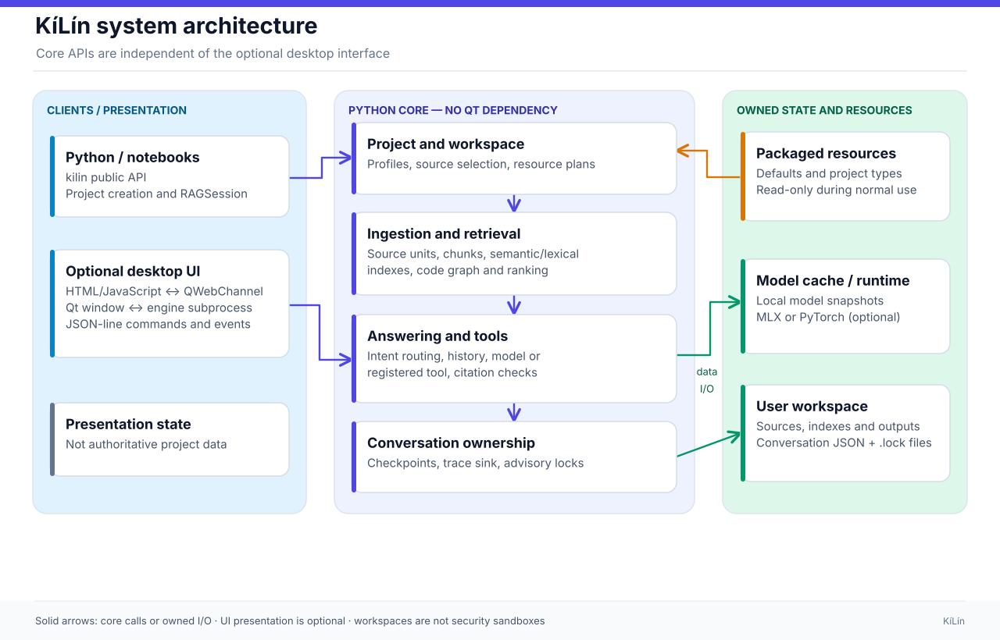

# KíLín architecture

## Purpose and current scope

KíLín is a local-first question-answering application and extensible Python
framework for working with user-supplied code and literature. The currently
shipped project types are `code` and `literature`. It provides a core API,
retrieval, locally executed model sessions, structured conversations, a set
of **registered built-in tools**, and an optional desktop interface. These
are implemented capabilities. Arbitrary plugin discovery, autonomous
multi-agent operation, secure code execution and distributed inference are
**not** established capabilities of this snapshot.

A major design invariant is that importing `kilin` does not construct a
model or start Qt. Project creation, source ownership, indexing, retrieval,
conversation persistence and tool contracts are core responsibilities. The
GUI is an adapter over these operations. See the source-level package facade
at [`kilin/__init__.py`](../kilin/__init__.py) to distinguish exported
names from private implementation functions.

## Executable boundaries

*Figure: The optional desktop has its own Qt-to-engine transport; the Python core owns projects, retrieval, answering and local persistence.*

The diagram is conceptual, not a claim that all calls form one synchronous
stack. The Qt window manages a child process; the engine dispatches commands
and emits JSON events. Tool confirmation can interrupt normal command
processing while an answer waits for a choice. The exact wire contract is in
[GUI protocol](gui_protocol.md), not this overview.

There are three distinct kinds of state: (1) packaged resources in the
installed module, (2) user-owned project files and application preferences,
and (3) live session state (loaded model references, in-memory turns, frontend
presentation state). Their lifetimes and owners must not be conflated.

## Main core components

| Layer | Modules and responsibility |
| --- | --- |
| API and entry points | `kilin/__init__.py` is the curated public facade; `cli.py` is the optional GUI launcher; `gui/__main__.py` launches the GUI directly. |
| Project lifecycle | `project.py` validates `profile.ini`, creates/opens workspaces; `project_layout.py` plans shared folders and tool resources. |
| Workspace contents | `workspace.py` imports cumulative sources; `project_files.py` edits outputs/templates; `workspace_resources.py` validates packaged resource declarations. |
| Selection and text | `repository.py` enforces scan policy and manifests; `sources/` supplies readers and provenance-bearing source units; `chunking.py` creates bounded chunks. |
| Retrieval | `retrievals/` builds semantic/lexical indexes and code graphs, persists checked index bundles, fuses rankings, and identifies named-document context. |
| Answering | `rag.py` coordinates an operation; `answering.py` routes intents and selects history; `chat.py` generates text; `embeddings.py` produces query/document vectors. |
| Models | `runtime.py`, `model_defaults.py`, `huggingface.py`, `query_formats.py` choose backends, model IDs, cached snapshots and embedding-query formats. |
| Tools | `tools/_registry.py` resolves configured built-in tool packages; `_contract.py` defines requests, context, and results; `_shared/` holds reusable private services. |
| Conversation | `conversations.py` owns the project catalog; `conversation_format.py` defines the stored state; `conversation_ownership.py` coordinates writers; `atomic_writes.py` replaces one file safely. |
| Diagnostics | `trace_logging.py` implements optional diagnostic events and shared conversation checkpoints; `docs/performance.md` describes trace-derived benchmarking. |
| Desktop | `gui/engine.py` orchestrates core operations; `window.py` owns Qt/QProcess/QWebChannel; `web/app.js` owns frontend state; supporting GUI modules own preferences/model choices/PDF rendering. |

The [module map](module_map.md) assigns all implementation modules (including
individual tools and language-specific readers) to a document. Module
imports and `__all__` declarations define actual callable boundaries;
architecture tables are explanatory, not an alternate API specification.

## Lifecycle of a project

1. **Select sources.** The scanner previews a directory with packaged and
   caller-supplied filters. Explicit individual-file imports have separate
   eligibility rules and must not be inferred from directory preview alone.
2. **Create workspace.** `initialize_project` validates a project type,
   profile and resource plan; new projects place `profile.ini` last as the
   initialization completion marker. `open_project` validates existing
   profiles without overwriting user templates.
3. **Open session.** `RAGSession` resolves paths, acquires exclusive
   conversation ownership, opens a trace or disabled-trace equivalent,
   inspects source changes and builds or reuses indexes, then constructs
   model sessions.
4. **Answer.** Project-type intents determine routing, history policy,
   retrieval mode and optional tool. Evidence and its provenance accompany
   the model or tool answer; successful turns are checkpointed.
5. **Resume.** Conversation selection and metadata are managed separately
   from loading an answer model. A session can change conversations without
   rebuilding indexes or models (subject to any encountered errors).
6. **Close/recover.** Session cleanup releases model references and
   conversation ownership; persistent indexes and completed turns remain.

See [Source pipeline](source_pipeline.md), [Retrieval pipeline](retrieval_pipeline.md),
[Answering pipeline](answering_pipeline.md) and
[Conversation ownership](conversation_ownership.md) for the precise
contracts. Project creation and source synchronization are **different**
transactions; a successful source import may remain after a later import
fails.

## Data ownership and isolation

A workspace is an organizational directory, **not a process security
sandbox**. Core folders include `profile.ini`, `indexes/`, `logs/`,
`outputs/`, and `templates/`, plus a source location depending on the
creation API. In cumulative managed imports, `sources/` and `sources.json`
track selected copies; the single-origin mirror instead uses
`source_snapshot.json`. Source originals should not be modified by import.

A saved project's `profile.ini` takes precedence over new-project defaults.
The desktop's immutable `gui/defaults.json` is combined with per-user
`preferences.json`, not rewritten in place. The project's own model and
search settings still take precedence. Installed GUI workspaces belong in a
user-owned data directory, while a recognized source checkout defaults to
its `sandbox/`. See [Configuration](configuration.md).

A conversation file can contain both committed turns and detailed traces.
Advisory companion-file locks coordinate KíLín writers; atomic replacement
protects individual writes, but does not create a multi-file database
transaction or prevent a noncooperating local process from altering files.
See [Conversation ownership](conversation_ownership.md) and
[Security](security.md).

## Dependency and extension rules

- The core must be useful without importing Qt, WebEngine or a GUI module.
- Project types are declarative packaged JSON with validated intents; they
  do **not** load arbitrary Python modules.
- Built-in tools register through the existing registry and use `ToolContext`;
  tool packages own their defaults, documentation and optional resources.
- Source extraction is delegated by suffix, retaining source references;
  adding a format does not mean its contents are automatically safe or
  indexable.
- Retrieval methods operate on aligned chunks/indexes; persistent indexes
  are tied to source fingerprints and embedding-model identity.
- Model loading depends on selected backend, cached snapshots and settings;
  `allow_download` controls permitted model retrieval in model sessions.

Detailed extension instructions and failure cases appear in
[Extension interfaces](extension_interfaces.md). Avoid using internal
helpers as an implied stable public API simply because Python permits it.

## Failure and recovery boundaries

Invalid project types, profile values, tool settings or packaged resources
should fail validation instead of being silently reinterpreted. Missing
models or optional dependencies can prevent session construction; initial
cleanup attempts to release acquired locks and partially loaded sessions.
Index integrity mismatches cause a rebuild rather than trusting unchecked
vectors. Generation failure should not commit a successful answer turn.

The desktop Stop action **kills the engine process**; it does not suspend
and later resume inference. On restart, the page can request the exact
previous conversation ID; it cannot recover an unsaved partial generation.
The frontend activity timeline and diagnostic trace are different records.
See [GUI architecture](gui_architecture.md), [GUI protocol](gui_protocol.md),
and [Trace recording](trace_recording.md).

## Architectural checks before changes

For every PR touching these boundaries, verify: core import without Qt,
existing-profile precedence, source-original protection, index matching,
answer/citation/checkpoint semantics, lock ownership, and both test runners.
A performance optimization must additionally measure latency and preserve
observable results. The verification procedure is in
[Development](development.md).

## Project-type identity

`ProjectTypeId` identifies a validated `ProjectType` configuration;
`ProjectProfile.type_id` selects it for a workspace. All packaged type
definitions are available in deterministic filename order, including in
the GUI. Standard code/literature IDs are not mandatory. See
[configuration](configuration.md#canonical-identifiers-and-schemas) for
field names and [project workspaces](project_workspaces.md) for empty
creation and later source import.
