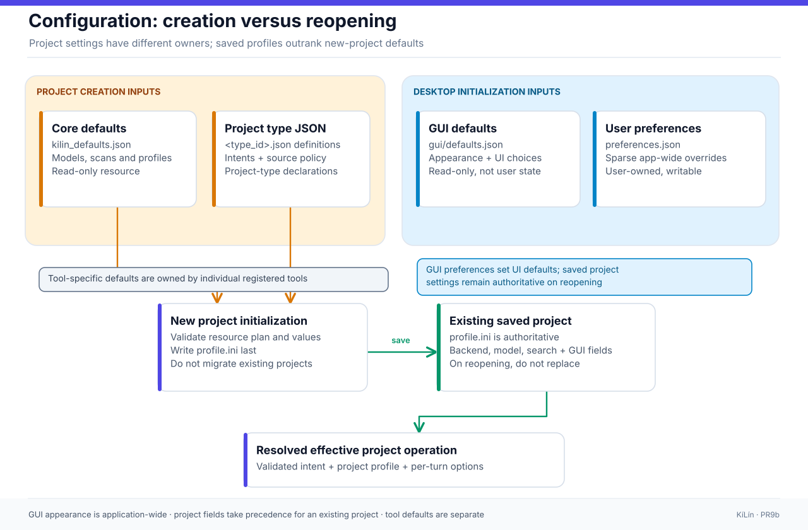

# Configuration, defaults and precedence

## Principle: settings have different owners

KíLín intentionally does not have one mutable global configuration file.
Packaged default values, project-type definitions, persistent project
profiles, per-user GUI preferences, tool-specific defaults and per-turn
options have **different lifetimes and authority**. A new default does not
rewrite an existing project's configuration.

| Layer | Source | Scope and owner | Mutability |
| --- | --- | --- | --- |
| Core packaged defaults | `kilin/kilin_defaults.json` | Initial models, project profile, chunking, retrieval, routing, scanner heuristics | Read-only packaged resource; loaded/validated by core |
| Project types | `kilin/project_types/<type_id>.json` | Eligible sources, intents, prompts, routing/retrieval behavior for a project type | Packaged declarations; not editable user profiles |
| Tool defaults | `kilin/tools/<tool>/defaults.json` | Parameter defaults owned by each built-in tool | Packaged and validated by that tool |
| GUI packaged defaults | `kilin/gui/defaults.json` | Appearance and initial GUI model/search preferences | Read-only application resource |
| User GUI preferences | Per-user `preferences.json` | Sparse overrides of GUI defaults, e.g. appearance | Atomic user-owned write |
| Project profile | `<workspace>/profile.ini` | Backend, model IDs, source filters, chunk sizes, search and generation values; GUI effort/router choices | Persistent, authoritative for the opened project |
| Per-answer arguments | `RAGSession.ask(...)` | Retrieval count, routing choice, generation updates, answer guidance | In-memory until saved according to the parameter contract |
| Runtime state | Backend availability, cached revisions, loaded sessions | Selected implementation state | Resolved at execution, not a package default |

Read [Package defaults](package_defaults.md) for **every key** in the core
JSON and its validated type/range. For exact GUI user-preference keys and
current model presets see [GUI README](../kilin/gui/README.md),
`gui/defaults.json` and `gui/preferences.py`. For each tool's parameters
use its README and `_configuration.py`.



*Figure: Packaged creation defaults do not overwrite saved project profiles; application-wide GUI preferences and tool-owned defaults have separate roles.*

## Initialization versus reopening

A new project's `type_id` selects a validated `ProjectType`; the core then
constructs and validates a `ProjectProfile` using `PROJECT_PROFILE` defaults
and the type's source defaults. `initialize_project()` installs declared
tool resources and commits the new `profile.ini` **last**. It must not
rewrite an existing profile when the packaged defaults change. All creation
APIs reject explicit occupied destinations; default naming allocates a new
folder. Neither settings overrides nor matching project types authorize reuse.
`open_project()` validates the saved profile and the resolved source path;
it does not opportunistically copy/replace templates based on a new
version of a tool. These invariants are detailed in
[Project workspaces](project_workspaces.md).

`kilin.project.configure_project()` is the core API for validated project
settings. GUI-specific project settings (effort levels, search-depth steps,
router model) are saved in additional `profile.ini` sections by
`kilin.gui.model_settings`. They are not a separate active
`effort_levels.json` database. The module still supports a controlled
migration of recognized older files on first use; moving or deleting files
outside that migration is not authorized.

### Important distinctions

- **Model role vs model ID:** role constants describe purposes such as chat
  and embeddings; default IDs are suggested choices, not an allowlist.
- **Backend vs device:** `auto` selects MLX or PyTorch; PyTorch independently
  chooses CUDA/MPS/CPU based on availability. The GUI dependency bootstrap
  does not override an already-saved project backend.
- **Default chunking vs profile chunking:** direct `chunk_source_units()`
  defaults are not identical to a newly created project's persisted sizes.
- **Project-type defaults vs project overrides:** type JSON affects intent
  resolution, instruction and default scope, while saved profile values
  determine current model, filters and indexing settings.
- **Router/effort/depth:** routing selects an intent, effort chooses an
  answering model as supported by the backend, and search depth chooses the
  number of passages; these are separate controls.
- **Question guidance:** intent-specific answer guidance takes precedence
  over caller guidance and project-type guidance; an explicit empty string
  can suppress project default guidance but not a configured intent rule.

## Core packaged defaults

`kilin.defaults.load_defaults_section()` reads the packaged core JSON via
`importlib.resources` and provides typed validators. Individual modules
validate the sections they own, rather than trusting arbitrary JSON values.
The resource is loaded once per process, not watched for hot reload.
Missing keys, invalid types and incompatible values raise errors; the
validator does not rewrite or repair the shipped resource.

The sections are `DEFAULT_MODELS`, `REPOSITORY`, `ANSWERING`, `RAG`, `CHAT`,
`PROJECT_PROFILE`, `CHUNKING`, `PROJECT_TYPES`, and `RETRIEVAL`. The
`DEFAULT_MODELS` section provides initial MLX/PyTorch chat and embedding
identifiers. `PROJECT_TYPES` provides bounded fallbacks for fields omitted
in an intent (for example a default document token budget); it does not
select which intent should answer an arbitrary question. `CHAT` owns the
language/script vocabulary used in positive CJK output requests; a keyword
mention alone does not grant permission. The per-project `[generation]`
`block_unrequested_cjk` flag controls whether suppression is enabled, with
`PROJECT_PROFILE.BLOCK_UNREQUESTED_CJK` as the fallback for older profiles.

Changing scanner exclusions or the answer-routing heuristic vocabulary in
this JSON changes future operations and can affect previously created
projects after restart where those global heuristics remain in use. Such
changes require behavior-focused regression tests, even if no file format
changes.

## Project type JSON and intent precedence

The type loader reads `project_types/*.json` in filename order, uses each
filename stem as its type ID and caches validated records. An invalid
project type is an error, not silently skipped. The top-level object defines
its display metadata, source-folder convention, extensions, size limit,
base prompts,
retrieval instruction, code-graph policy, history defaults, default intent,
intents, welcome prompts and suggestions.

An intent can override inherited prompt/history/retrieval settings, specify
shortcut regexes and select a registered tool. The parser gives missing
fields documented defaults (including `search` for ordinary intents and
`none` when a tool is named). It rejects invalid tool or retrieval
combinations. A project type cannot load arbitrary Python code by naming
it in JSON; only registered tool IDs are accepted. See
[Extension interfaces](extension_interfaces.md).

### Per-intent thinking policy

An intent may set `thinking` to `true`, `false`, or `null`. Omitting the
field is equivalent to `null`: inherit the loaded chat session's configured
setting. This is inheritance, not automatic reasoning-effort selection.
Strings such as `"false"`, numbers, arrays, and objects are rejected.

For ordinary model answers, an explicit boolean overrides the configured
setting for **that reply only**, including a thinking setting passed in
`RAGSession.ask(generation_settings=...)`. Those generation updates still
persist on the session; the intent override never rewrites them, the project
profile, or GUI preferences. It does not switch models, change token budgets,
or add a model call. Both packaged `small_talk` intents set `thinking` to
`false`; other packaged intents inherit the session setting.

For example, a minimal ordinary intent can declare:

```json
{
  "description": "Greetings and thanks.",
  "system_prompt": "Reply briefly without citing sources.",
  "history": {"policy": "none"},
  "retrieval": {"mode": "none"},
  "thinking": false
}
```

This object belongs under an intent key in the project type's `intents`
object. Tool-backed intents must omit `thinking` or set it to `null`;
explicit booleans are rejected because tools own their internal model calls.
The policy does not control the router or other side requests. Disabling
routing still selects the configured default intent and its policy.

The control uses the selected model's existing `enable_thinking`
chat-template argument. Templates or models that do not support this control
cannot be made non-thinking by this setting; no model fallback or output
filter is added. Restart after editing a packaged project-type JSON because
validated types are cached. Existing workspaces use the updated intent policy
on subsequent requests after restart; saved answers are not rewritten and no
profile migration or reindexing is needed.

Saved turn parameters keep `thinking` as the configured value used to restore
a conversation. Direct model answers additionally record `thinking_effective`
as the resolved value requested for that answer; tool answers do not claim a
single effective thinking policy. See [Model management](model_management.md)
and [Trace recording](trace_recording.md).

### Canonical identifiers and schemas

`ProjectTypeId` is an open string alias, not a closed enum. A validated
`ProjectType` has an `id`; an individual `ProjectProfile` has a `type_id`.
`kilin.PROJECT_TYPE_IDS` contains all packaged IDs in filename order.
`PROJECT_TYPE_ID_CODE` and `PROJECT_TYPE_ID_LITERATURE` name the standard
configurations without requiring their presence. Any nonempty collection
of valid packaged definitions is supported. An unknown ID or an empty or
invalid registry is an error. Definitions are cached: restart after edits.

The current representations are:

| Boundary | Identifier field |
| --- | --- |
| Python `ProjectType` | `id` |
| Python `ProjectProfile` and serialized profile snapshots | `type_id` |
| `profile.ini`, `[project]` section | `type_id = code` |
| GUI commands, project lists and project-type choices | `type_id` |
| Index settings, turn parameters and intent trace metadata | `project_type_id` |
| Project-type JSON files | Filename stem; no duplicate ID field |

This is a clean prerelease change. Former Python project-kind names and
old profile/protocol/metadata keys have no aliases or migration readers.
Recreate development workspaces that use the previous profile schema;
do not expect old index or trace metadata to match the new contracts.
The unrelated `kind` fields on source entities and chunks are unchanged.

### New-project source convention

`source_directory` is an optional project-type JSON string with default
`"sources"`. It must be a nonempty relative POSIX directory path: no
absolute or drive paths, backslashes, colons, control characters, empty,
`.` or `..` components, surrounding whitespace, trailing dots, Windows
reserved device names or characters, or the INI interpolation marker `%`. The
managed `indexes`, `logs`, `outputs`, and `templates` folders cannot be
selected as a source convention. Nested relative paths are allowed.

The standard code definition specifies `"repository"`; literature specifies
`"documents"`. `initialize_project()` creates this subdirectory inside a
nonexistent or empty destination. It no longer adopts nonempty source folders
or reopens saved projects. `open_project()` reads a saved profile's explicit
`source` unchanged and performs no filesystem writes. The convention creates
no example files. Managed multi-source workspaces always use `sources/`,
including when created empty; their layout is independent of this setting.

## GUI defaults and writable preferences

`gui.preferences.built_in_defaults()` reads immutable packaged GUI defaults;
`app_defaults()` merges **validated sparse** user preferences over those
built-ins. `write_defaults()` validates and atomically writes deviations to
a user-owned `preferences.json`, leaving the packaged resource unchanged.
Missing user preferences are normal on first run. Invalid values are
reported, not silently substituted with unknown settings.

By default GUI preferences live in a per-user configuration directory;
`KILIN_DEFAULTS_FILE` is an explicit **absolute-path** override for that
user preferences file (despite its historic name). It does **not** point to
the immutable shipped defaults during normal use.

A recognized development checkout defaults GUI workspaces to its repository
`sandbox/`; an installed package uses a user data folder. Explicit
`KILIN_WORKSPACES_DIR` (absolute or home-expanded) overrides the default,
and a workspace explicitly chosen in the GUI overrides the suggested
parent. No installed package directory should become the normal writable
location for conversations, workspaces or preferences. See
[GUI architecture](gui_architecture.md) and [GUI README](../kilin/gui/README.md).

### Saved project settings take precedence

Once a project exists, `profile.ini` is authoritative for its saved model,
router, search depth and other project settings. The GUI does not silently
replace them when its packaged/global defaults change. GUI-wide preferences
are initial values for a new project and presentation choices; they are not
permission to reinterpret an existing project's saved sources or tools.

## Tool configuration and resources

`tools/_registry.parse_tool()` reads a project-type tool declaration,
resolves a **registered built-in name**, and calls that tool's own
`parse_settings()` implementation. `tools/_defaults.py` validates
`defaults.json` owned by the package. Unknown settings should fail early.
Tool resource declarations are planned by the core and installed only for a
new workspace (or upon explicit restoration), preserving user-edited files.

The main tool configuration reference is
[Tool packages](tool_packages.md); the full installed resource ownership
contract is [Project workspaces](project_workspaces.md).

## File-selection protocol constants

Repository scan reason identifiers live in one validated
[`repository_reason_codes.json`](../kilin/repository_reason_codes.json)
resource. Python exposes named constants through
`repository_reason_codes.py`, and the GUI settings event supplies the same
mapping to JavaScript. Human-readable skip messages are **not** protocol
identifiers. The JSON resource is packaged with the wheel; invalid,
duplicate or unexpected entries fail validation. See
[GUI protocol](gui_protocol.md) and [Source pipeline](source_pipeline.md).

## Configuration changes and reproducibility

A reproducible session report needs at least project type, saved profile
(including backend/model IDs, chunk/search values and allow-download flag),
selected source snapshot, loaded model revision/identity, query format,
actual retrieval query and optional trace configuration. An ID in a default
JSON is not proof that a particular model revision ran.

Source selection changes can invalidate manifests; chunk/tokenizer/query
format or embedding-model changes can invalidate retrieval caches; route
shortcuts and intent instructions can change answers without reindexing.
Unit tests should validate each ownership/precedence boundary and refusal
of malformed configuration. Include an installed-wheel test when adding a
new packaged JSON resource.

Related: [Package defaults](package_defaults.md),
[Model management](model_management.md), [Project workspaces](project_workspaces.md),
[Tool packages](tool_packages.md), [Development](development.md).

### Internal tool thinking

Each registered tool owns a validated `MODEL_CALLS` section in its packaged
`kilin/tools/<tool>/defaults.json`. It controls internal `context.ask_model`
requests through the same core adapter in the GUI and direct API. It does
not change intent routing or the user-visible `context.write` policy.

```json
"MODEL_CALLS": {
  "THINKING": "inherit",
  "SHORT_REPLY_THINKING": "off",
  "SHORT_REPLY_MAX_TOKENS": 512
}
```

Resolution order is explicit:

1. `THINKING: "on"` or `"off"` forces every internal call.
2. With `THINKING: "inherit"`, an explicit positive output-token request at
   or below `SHORT_REPLY_MAX_TOKENS` uses `SHORT_REPLY_THINKING`.
3. Otherwise, or when the selected policy is `"inherit"`, use the main
   answering session's current thinking setting.

Both policy fields accept exactly `inherit`, `on`, or `off`; booleans,
unknown values and misspelled keys are rejected. The bound is an integer
from 0 to 100000, inclusive; zero disables the short rule. The bound uses
the tool's requested output budget, before the session ceiling, not the
length of the user's question. A `None` budget inherits the session limit
and is not treated as short. This is deterministic configuration, not a
second model-based classification.

| Tools | Packaged policy | Rationale |
| --- | --- | --- |
| `find_passages`, `filter_results`, `batch_classify` | `off`; no short override | Return bounded numbers or labels, not narrative analysis. |
| `batch_review`, `find_fact`, `generate_paper_summary` | `inherit`; `off` through 512 tokens | Short notes and report metadata must fit; longer drafting inherits. |
| `reference_check`, `suggest_reference` | `inherit`; `off` through 512 tokens | Normal judgments with no explicit cap inherit; explicitly capped short calls can opt out. |
| `show_source`, `paper_overview`, `project_inventory`, `scan_and_list` | Full `inherit`; no short override | Narrative explanation or no internal answering calls. |

The fallback policy object is full inheritance. Every shipped tool declares
its policy explicitly. To reset any tool to full inheritance, use
`THINKING: "inherit"` and `SHORT_REPLY_THINKING: "inherit"` (or a zero
bound). To enable thinking for every internal call, use `THINKING: "on"`.
Restart the app or notebook kernel after editing cached defaults. No project
migration or reindexing is needed. These are tool defaults, not fields of
project-type intent objects or `profile.ini`.

Overrides do not change temperature, model identity, token ceilings or call
counts. Final `context.write` responses still inherit the main interface
setting; router/title requests remain greedy and nonthinking. All settings
and isolated messages are restored on success and failure. Models that
ignore `enable_thinking` cannot be forced into a different mode by this
policy. No retry or extra model is introduced.

The saved tool summary's `internal_generation` records the policy and each
executed call's effective thinking, requested output cap and completion
status. Detailed model traces retain the actual generation parameters.
Forcing thinking on a short budget can still cause an incomplete response;
the [completion contract](answering_pipeline.md#model-output-completion-contract)
prevents that failure from being mistaken for a valid negative result.
