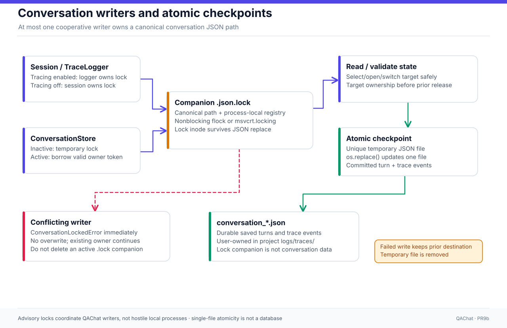

# Conversation-file ownership

KíLín stores resumable conversation state and, when tracing is enabled,
structured diagnostic events in the same `conversation_*.json` document.
The session's checkpoint and callback lifecycles distinguish committed turns
from unsuccessful operations. This document describes how KíLín keeps
individual conversation files consistent across components and processes.

## The ownership contract



*Figure: Companion-file advisory ownership coordinates KíLín writers while atomic replacement protects one committed conversation file.*

**At most one active KíLín writer can own a canonical conversation JSON path
at any time.** Before reading an existing conversation for modification, a
writer must acquire exclusive ownership. A conflicting acquisition raises
`ConversationLockedError` immediately; it never replaces the conversation
JSON or waits indefinitely for the existing writer.

The implementation lives in `kilin/conversation_ownership.py`:

- `ConversationFileLock(path)` holds exclusive ownership for the duration of
  an open session or a short-lived store operation.
- `conversation_write_ownership(path, ownership=...)` validates an already
  held token or acquires and releases a temporary lock.
- `ConversationLockedError` is a `RuntimeError` indicating an active writer.
  I/O failures such as permission errors remain `OSError`.

`ConversationFileLock` canonicalizes paths with `Path.resolve()` before
checking ownership. Path aliases such as `/var` and `/private/var` on macOS
therefore cannot create separate owners for the same file.

The OS lock belongs to a persistent *companion file*, such as:

```text
logs/traces/
    conversation_2026-10-12T20-00-00.json
    conversation_2026-10-12T20-00-00.json.lock
```

On macOS/Linux, the lock uses nonblocking `fcntl.flock`. On Windows, it uses
`msvcrt.locking`. A process-local registry also rejects competing instances
inside one Python process. The JSON itself is atomically replaced, so the
lock cannot be attached to its replaceable inode. The companion remains on
disk after closure; **its existence does not mean that the file is locked**.
Do not remove lock files while KíLín may still be using them, because a
removed/recreated companion can break coordination between writers.

## Lifetimes and ownership

| Component | Who holds the lock? | When is it released? |
| --- | --- | --- |
| `TraceLogger` | Its own `ConversationFileLock` | `close()`, including exceptions during the final write |
| `RAGSession` with an owned trace | The owned trace logger | Session close or failed initialization |
| `RAGSession` with a caller-owned trace | The caller's trace logger | The caller must close the logger |
| `RAGSession` with tracing disabled | An independent session lock | Session close, successful switch away, or failed initialization |
| `ConversationStore` editing an inactive conversation | A short-lived lock | The operation returns or raises |
| `ConversationStore` editing the active conversation | A borrowed owner from RAG or the GUI logger | The originating owner releases it |

Passing an ownership token to a store operation does not transfer the lease.
The store checks the token and never releases a borrowed lease. GUI metadata
updates (`rename`, `touch`) and branch creation borrow the active owner;
otherwise the store acquires a temporary lease for the target. The store
cannot update or archive a conversation owned by another process.

For an active traced conversation, the GUI supplies the trace's
`update_conversation` callback as the store's `state_writer` argument. The
store validates the saved record, invokes that writer while borrowing the
existing lock, and changes its in-memory metadata **only after a successful
write**. There is no separate store write to overwrite with a stale trace
snapshot later. When tracing is disabled or the record is inactive, the store
uses its own atomic JSON writer. Callers using `state_writer` must ensure that
it targets the same file as the borrowed ownership token.

A tracing-disabled RAG session *still saves checkpoints* and retains
exclusive ownership. This is important because disabling diagnostic tracing
must not disable persistence protection.

## Switching, resetting, and archiving

When switching conversations, RAG acquires (or validates) the target lock
and reads its state **before releasing the previous writer**. If acquisition
or initial state validation fails, it retains the prior conversation path,
turns, and ownership. Later model/history reconfiguration is not guaranteed
to roll back as one transaction.

The GUI attempts to open the destination trace before closing the current
one. If the new logger cannot acquire its target, the previous GUI trace
remains active. This also works when the GUI owns the trace used by RAG:
RAG borrows it rather than acquiring a second lock.

`RAGSession.reset()` archives the current file while owning its path and
continues with a fresh conversation under that same path. The GUI's
`ConversationStore.archive()` borrows the active owner where applicable,
then moves the JSON to `logs/traces/deleted/`. In the deletion flow, the GUI
closes the old logger with `emit_event=False` to release ownership without
rewriting the already archived JSON. An inactive conversation is locked
independently during archival.

## Atomic writes and cleanup

Conversation JSON, trace output, and supporting project metadata are written
through the internal `atomic_write_text` helper. It creates a fresh,
uniquely named temporary file in the destination directory and atomically
replaces the destination after completing the write. A pre-existing `.tmp`
symlink cannot redirect the write; an unsuccessful write or replacement
removes the temporary file and preserves the prior destination. The same
helper is used for cached source text and GUI answer timelines. File-format
choices (such as indentation and sorting) remain with the callers.

This atomicity concerns **one file at a time**. It does not synchronize
multiple files, protect against programs bypassing the advisory lock, or
force data to stable storage after power loss. File access and permissions
remain the responsibility of the local environment; this helper introduces
no configurable permissions policy.

On `RAGSession.close()`, KíLín attempts to close every owned model, its
owned trace, and its direct-write lock even if one cleanup step raises. The
first failure still propagates, with later failures attached as exception
notes. Errors during partial initialization likewise do not prevent other
models or the owned trace from being cleaned up.

## Errors and recovery

For example, a second writer can be opened safely only after the first
has closed:

```python
from pathlib import Path

import kilin
from kilin.conversation_ownership import ConversationLockedError

path = Path("/path/to/project/logs/traces/conversation_example.json")
config = kilin.TraceConfig(enabled=True, output_path=path)
first = kilin.TraceLogger(config, default_directory=path.parent)
try:
    try:
        kilin.TraceLogger(config, default_directory=path.parent)
    except ConversationLockedError:
        # The first logger still owns the path and can keep writing.
        pass
finally:
    first.close()
```

Normal cleanup explicitly closes the active logger and any RAG-owned direct
lease. If an independent process exits unexpectedly, the operating system
releases its OS lock. The `.lock` file may remain; it does not need manual
cleanup. A failure while opening an existing trace releases any newly
acquired lock even if the saved JSON is invalid. Failure to acquire a lock
does not alter the existing conversation JSON.

These locks are **advisory**. They coordinate KíLín components that use the
ownership protocol; they cannot prevent another program from ignoring the
companion file and modifying the JSON. They do not provide encryption,
resistance to hostile local processes, a durable disk-flush guarantee, or a
transaction spanning multiple files or the store's in-memory registry.

## Regression testing

The following suites cover the main ownership guarantees:

```sh
python -m pytest -q \
    tests/kilin/test_conversation_ownership.py \
    tests/kilin/test_trace_logging.py \
    tests/kilin/test_rag.py \
    tests/kilin/test_conversations.py \
    tests/kilin/gui/test__conversation_ownership.py
```

Tests verify competing writers in one process and across separate processes,
canonical path aliases, recovery after abrupt process termination, failed
trace construction, trace-close errors, tracing-disabled persistence, active
metadata updates, archival, and GUI target-switch conflicts. Each test runs
with isolated local files and no model downloads.

The project requires Python 3.12. Verify platform-specific locking on macOS
and Windows in addition to any local CI environment.
