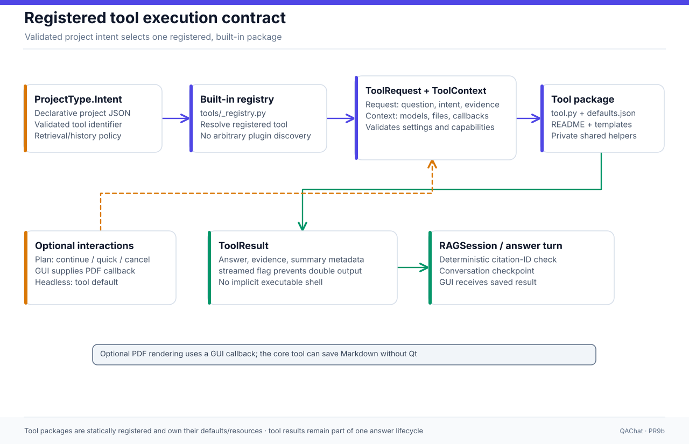

# Extension interfaces and tool architecture

## Extension philosophy

KíLín is extensible through **explicit, validated components**, not by
loading arbitrary Python code mentioned in a project JSON. A new reader,
project type or registered tool must preserve provenance, settings and
workspace ownership and must not require Qt in the core. This document
explains the implemented extension points and where modification is needed;
there is no general-purpose runtime plugin discovery service in this
snapshot.

| Extension | Registration / owner | Main invariant |
| --- | --- | --- |
| Project type | `kilin/project_types/<kind>.json` read by `project_type.py` | Validate all intents, tools, sources and prompts before use. |
| New source format | `sources/extensions/sources_<suffix>.py`, dispatched by `sources.py` | Return well-formed `SourceFile` / `SourceUnit` records with exact provenance. |
| Code graph language | `retrievals/code_graph/extensions/` | Extract structural hints without executing source code. |
| Built-in tool | `tools/<name>/` plus `tools/_registry.py` | Validate settings; honor `ToolRequest`, `ToolContext`, `ToolResult`. |
| Tool workspace asset | Tool's `workspace_resources(settings)` and `project_layout.py` | Declare safe relative destinations, install in core, preserve user edits. |
| Model backend | `chat.py`, `embeddings.py`, `runtime.py` | Maintain validated session, tokenizer and vector/generation contracts; not a JSON-only extension. |
| Retrieval strategy | `retrievals/strategies/` and `rag.py` integration | Preserve chunk alignment, ranking and evidence coordinates; not dynamically registered today. |

## Creating a project type

The shipped examples are `code.json` and `literature.json`. A new type is a
packaged `<kind>.json` resource with validated `display_name`, `description`,
`extensions`, `max_file_bytes`, `retrieval_instruction`, `system_prompt`,
optional `answer_guidance`, `capabilities`, history settings, a valid
`default_intent`, an `intents` object and optional empty-chat prompts. The
loader derives the type ID from the filename, rejects duplicate JSON keys,
and validates **all** type files on load.

Each intent key names an operation. Its fields may supply a description,
shortcuts, history policy, retrieval mode/strategy, instruction, and a tool
reference. `Intent` is the validated in-memory record; its values are not
always a literal one-to-one copy of keys in JSON because the loader applies
defaults. Supported history modes are `none`, `recent`, `relevant`; supported
retrieval modes are `none`, `search`, `document`, `reuse`. The implemented
retrieval strategy is `hybrid`. A missing tool name or an unregistered name
fails validation rather than importing a module by string.

Adding a new project type requires checking its source-selection defaults,
router prompts, installed tool requirements, selected template resources,
and how the GUI lists it. Merely adding a kind ID is not proof that the
entire pipeline supports its source formats or domain reasoning.

## Source reader/extractor contract

`sources/sources.py` dispatches by supported extension to modules under
`sources/extensions/`. A reader may implement `read_source_file(path,
relative_path)` to load non-UTF-8-backed content (the PDF reader does).
An extractor implements `extract_source_units(...)` using the signature
expected by the dispatcher. Returned records must use consistent relative
paths, exact text, inclusive source-coordinate ranges and valid symbol,
section and cell fields. Reading a file does not execute its code.

When adding a suffix:

1. Specify binary versus UTF-8 reading and optional dependencies.
2. Implement deterministic units with stable order and correct provenance.
3. Add validation/dispatch and tests for empty, malformed and unusually
   large content; do not assume a file named `.pdf` is parseable.
4. Ensure citation previews can interpret the coordinates (especially PDF
   page-local and notebook cell-local line numbers).
5. Recheck chunk identities, source manifests and incremental index reuse.
6. Update project-type suffix defaults **only if** the kind should select
   the new format automatically; explicit files follow different policy.

Code relationship extractors for Python and MATLAB live under
`retrievals/code_graph/extensions/`; their results are heuristic, not
execution or complete semantic analysis. Adding another language may also
require source-unit conventions, graph entity typing and retrieval tests.

## Implementing a built-in tool



*Figure: The tool registry, request/context contract, optional confirmation callbacks and answer persistence are explicitly owned interfaces.*

All tools are registered under `kilin/tools/`. Existing packages demonstrate
the expected structure:

```text
kilin/tools/<name>/
    __init__.py
    tool.py                 # Settings dataclass, parse_settings(), run()
    _configuration.py       # Validate owned defaults
    defaults.json
    README.md
    [templates/ or other packaged assets, if needed]
```

`tools/_registry.py` defines canonical `TOOL_*` identifiers and an entry for
each tool. Registration pairs the ID with its parser and runner, optional
`follows_up` behavior and optional `workspace_resources` callback. A project
type may **select** an existing registered tool, but cannot register another
implementation from JSON. Each package owns its settings validation and
its own documentation; shared services belong in `tools/_shared/` rather
than imports from a sibling tool.

### Request and context

`ToolRequest` includes the user's question, search-relevant user text,
optional guidance and referenced earlier turns. `ToolContext` supplies the
project root; all indexed chunks; the code graph; a ranking callback;
retrieval count; source-file and unsearchable-file queries; controlled router
and answering-model calls; streaming output; progress/done callbacks;
confirmation; trace and turn ID; optional PDF writer; and optional document
choice callback. These are **capabilities supplied by the caller**, not
license to bypass project file ownership.

`ToolResult` has four fields:

- `answer`: final Markdown text, with numeric citations if evidence exists;
- `evidence`: provenance records numbered to match the answer;
- `summary`: JSON-compatible tool metadata saved with the turn;
- `streamed`: whether the answer was already emitted through the context
  writer (avoid duplicate output).

`parse_settings` should reject unknown names and invalid types before a
model run. `run` must return a valid result or propagate an explicit error.
A tool that needs many model calls should produce a `ToolPlan` and follow
the configured confirmation behavior. `continue`, `quick` and `cancel`
are exact user-choice identifiers; Quick may intentionally be a smaller,
nonexhaustive operation. Headless callers may not supply a confirmation
callback, so document the default policy and cost.

### Available built-in tools

| Tool ID | Main implementation purpose | Authoritative reference |
| --- | --- | --- |
| `project_inventory` | Summarize selected files and unsearchable source coverage. | [README](../kilin/tools/project_inventory/README.md) |
| `scan_and_list` | Count and list literal mentions with source locations. | [README](../kilin/tools/scan_and_list/README.md) |
| `batch_classify` | Classify many mentions in model-assisted batches. | [README](../kilin/tools/batch_classify/README.md) |
| `batch_review` | Read one document in parts and answer from notes. | [README](../kilin/tools/batch_review/README.md) |
| `filter_results` | Filter items of an earlier answer against a follow-up. | [README](../kilin/tools/filter_results/README.md) |
| `find_fact` | Find one fact or a complete set across a document/corpus. | [README](../kilin/tools/find_fact/README.md) |
| `find_passages` | Locate relevant literal passages/sentences. | [README](../kilin/tools/find_passages/README.md) |
| `paper_overview` | Produce a structured overview of a paper. | [README](../kilin/tools/paper_overview/README.md) |
| `reference_check` | Check a paper's references against the project's files, find their citations, and judge each claim against the cited paper. | [README](../kilin/tools/reference_check/README.md) |
| `suggest_reference` | Find the papers in the project that could be cited for a statement, each with a checked quote. | [README](../kilin/tools/suggest_reference/README.md) |
| `show_source` | Display requested exact source context. | [README](../kilin/tools/show_source/README.md) |
| `generate_paper_summary` | Create template-driven reports and saved artifacts. | [README](../kilin/tools/generate_paper_summary/README.md) |

These tools do not have identical output formats, costs or confirmation
policies. Consult their own READMEs, `defaults.json` and tests before
assuming reusable behavior.

## Workspace resources are declared, not blindly copied

A tool may declare a tuple of `WorkspaceResource` records from
`workspace_resources(settings)`. The project layout planner validates the
owning package, source regular-file status, destination, containment and
conflicting declarations. The core creates `templates/` and copies only
missing declared resources for a **new** project. Existing user files are
not overwritten on reopening. The `generate_paper_summary` tool currently
ships Markdown templates installed according to active literature intents;
other current tools do not require installed workspace files.

A new optional report template must not be copied into every project simply
because it is shipped in a package. The configured tool/intent should
request it, and an opt-in repair operation can restore a missing file without
silently overwriting an edited one. See
[Project workspaces](project_workspaces.md).

## Shared private services

`tools/_shared/` currently groups document selection, note-taking/citations,
prior-turn matching, mention and term scanning, sentence splitting,
reference-list extraction, planning,
path disambiguation, safe output-file access and source statistics. These
modules are private implementation helpers. Prefer them when semantics match,
but do not silently move a tool's policy into a shared service unless
multiple tools really need the same contract.

The report-generation package has an additional `_report_template.py` and
`_report_format.py` to validate Markdown templates and report formatting.
The GUI offers PDF rendering through its optional `_report_pdf.py`; core
tools should still function without Qt (Markdown output remains available).

## Extending models or retrieval

This is source-code extension, not a configurable plugin point. A new model
backend must implement cache resolution, model/tokenizer loading, chat
formatting, generation, embedding normalization, explicit download control,
cleanup and tests on supported hardware. A new retrieval strategy must
preserve exact `Chunk` references, source positions, indexing identity and
fusion compatibility and be integrated with `RAGSession`; changing the
strategy can invalidate answer-ranking expectations even without changing
an index file format.

## Tests and review checklist

- Register explicitly; reject unknown tools/settings/intent references.
- Validate function return types and source provenance; handle malformed
  source/LLM output without hidden retries.
- Keep model access, source reading and filesystem work in core services.
- Check tool `summary` JSON serializability and citation/evidence numbering.
- Confirm resource destinations cannot traverse outside the project or
  overwrite edited user files.
- Preserve `kilin` imports without Qt and test the headless path.
- Test both project creation and reopened profiles; no unintended migration.
- Update tool README, local module docstrings and the module map.

The tool architecture tests are under `tests/kilin/tools/`; each tool also
has dedicated tests. For platform-specific GUI adapters, run appropriate
Qt smoke tests separately. See [Development](development.md).

Related: [Tool packages](tool_packages.md),
[Answering pipeline](answering_pipeline.md),
[Source pipeline](source_pipeline.md),
[Configuration](configuration.md).
