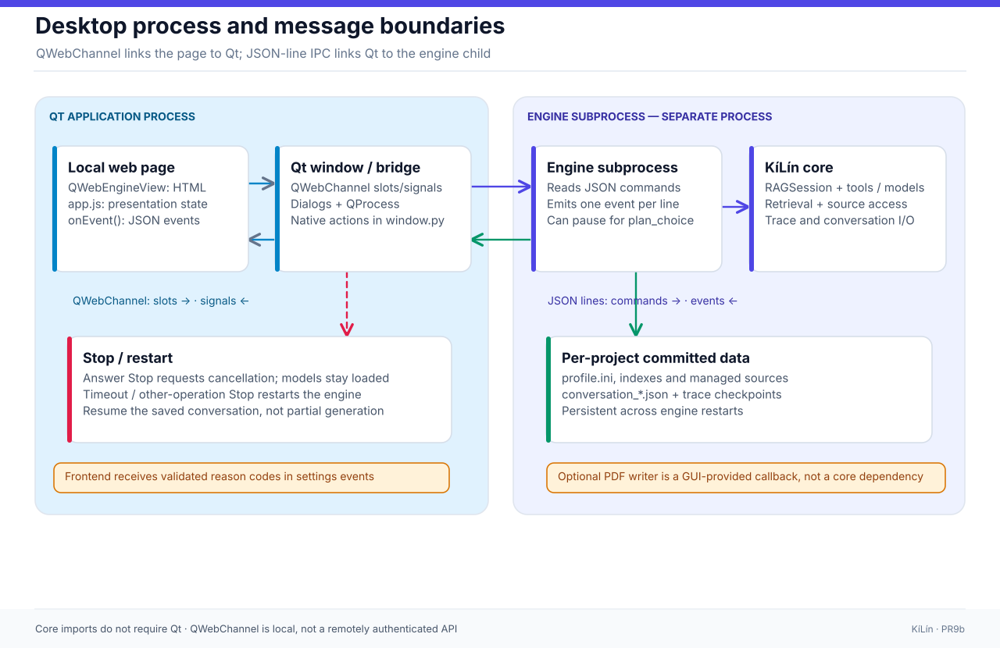

# Desktop GUI architecture and lifecycle

## Optional adapter, not the core application

The desktop interface is implemented with PySide6/Qt WebEngine and a local
HTML/CSS/JavaScript page. Importing `kilin` or running the Python core in a
notebook must not require Qt. The GUI provides a file picker, setup forms,
model management, project/conversation controls, progress, rendered answers
and reference previews; source policy, model sessions, indexing and
persistence remain delegated to Python core APIs.

The more detailed [GUI README](../kilin/gui/README.md) is the user- and
implementation-facing companion, while the exact command/event names and
payloads are owned by [GUI protocol](gui_protocol.md).

## Processes and message boundaries

*Figure: QWebChannel traffic stays inside the Qt process; newline-delimited JSON messages cross the engine subprocess boundary.*

`gui/__main__.py` launches `gui.app.main()`. The `kilin --gui` CLI can
first check/prepare optional dependencies using `uv` in a development
checkout, whereas `python -m kilin.gui` does not perform dependency
installation. The GUI process imports Qt; the child engine can run without
Qt for ordinary answering, except optional PDF rendering injected into
report tools. A Qt application's existence is a per-process global
constraint, which matters for integration test isolation.

`ChatWindow` owns the backend subprocess and QWebChannel bridge.
`ChatBridge` offers camelCase slots such as `openProject`, `askQuestion`,
`resumeProjectConversation`, `previewSources`, `choosePlan`, and
`stopOperation`. The bridge translates typed and JSON-encoded arguments into
backend commands or handles native OS actions itself. The engine reads
commands sequentially, writes structured JSON events and forwards runtime
output to diagnostic tracing instead of mixing arbitrary text into stdout.

The page's `onEvent` consumes the events and updates transient view state;
backend `opened`/`answered`/`conversations` events are not replaced by
frontend guesses about project storage. Core answer activities arrive as `answer_activity` events generated by
the same recorder that saves and traces them. Browser phase timers estimate
in-flight durations but do not produce activity labels. A character-by-
character answer reveal does not necessarily reflect backend token timing.

## Initial setup and project selection

Startup retrieves model choices, backend readiness, project types and
preferred/default settings. `gui/model_catalog.py` supplies the suggested
catalog and `huggingface.py` inspects the cache; a cached distribution is not
proof it will load. Model downloads are explicit GUI operations. Source
preview and the core workspace-creation stage do not load inference models;
subsequent session activation is a separate stage.

The page receives validated `type_id` entries from the core registry, selects
the first in filename order and keeps prompt-selection state for each type.
Labels and welcome content come from the type definition, with generic
source-independent fallbacks. Packaged definitions are examples,
not a GUI allowlist.

The engine previews directories through the core scanner and individual files
through the explicit-file path. The page uses `reason_code`, not display
wording, for selection decisions; exact eligibility and payload fields are
owned by the [source-preview protocol](gui_protocol.md#source-preview-contract).
Confirmed sources and settings are passed to core creation and indexing.
An explicit workspace permits an empty source selection; the engine never
substitutes an example repository.

### Creation, conflicts and activation

The core allocates fresh default destination names. An explicit occupied
destination yields `workspace_conflict`; the page may offer a separate
`resume` operation for an existing project or retain the new-project inputs
while the user chooses another location. The
[protocol contract](gui_protocol.md#project-type-identifiers) defines the
reported fields and which conflicts can be resumed. Filesystem reservation
and rollback belong to [Project workspaces](project_workspaces.md), not Qt.

Creation and profile/resource preparation finish before the engine closes
its current session or opens the new project's conversation and trace files.
A conflict leaves the current session and protected destination unchanged,
including trace bytes. Failures before switching are displayed without
writing an error to the previous project's trace. After creation, ordinary
session activation loads models and tracing; a model-load failure does not
delete the valid newly created project.

Saved projects are listed and resumed without recopying their original
sources. Later additions use `add_project_sources`, not a creation function.
Adding/removing confirmed managed sources refreshes retrieval; editing
outputs/templates through `project_files` does not. These are core operations
with different ownership, even when adjacent in the interface.

## Workspace ownership and paths

`gui/_paths.py` resolves writable config/data locations independently of Qt;
`gui/preferences.py` never treats the installed defaults file as writable
user state. A development checkout and an installed distribution can have
different suggested workspace parents. The exact path overrides and
preferences rules are owned by
[Configuration](configuration.md#gui-defaults-and-writable-preferences).

`gui/_activation.py` asks for the passkey in `gui/app.py`'s `main`, after
the Qt application exists and before `ChatWindow` is built, and keeps the
accepted passkey's hash in `activation.json` beside the preferences file.
Removing that call removes the prompt. Maintainers change the passkey, or
switch the prompt off with an empty digest, using the repository script
`setup/passkey.py` (`--passkey NEW` or `--off`), and commit the rewritten
module; the script is not part of the released package.

An existing project's profile remains authoritative. `gui/model_settings.py`
stores GUI-specific effort/search/router choices there rather than replacing
them from current global defaults. Its controlled legacy import is not a
general project migration. For changes to the saved source tree or resources,
use the [workspace APIs](project_workspaces.md#creation-opening-and-explicit-updates).

## Operation lifecycle and answer display

The GUI engine owns one `ChatEngine` and an optional live `RAGSession`. A
request to answer:

1. Validates the selected project, chat settings and current operation.
2. Chooses the required effort-model behavior and search-depth step.
3. Calls `RAGSession.ask()` with phase/token/progress callbacks and optional
   callbacks for tool plans, document choices and PDF output.
4. Sends `answer_phase`, progress, usage and answer-text events to the page.
5. Relays the committed turn, evidence, and core-owned timeline in
   `answered`; the page only renders these and the live progress display.

For a large tool plan, the backend can request a user choice **while the
answer is running**. The engine's `read_command` uses the same stdin iterator
for plan choices and ordinary dispatch; while awaiting a choice, unrelated
commands are consumed with an error rather than queued. Arbitrary parallel
command execution is not the current design. The page disables relevant
controls during model/index operations to reduce conflicting requests.

A numeric citation becomes a source-preview link only when it corresponds
to the answer's saved evidence record. Preview requests carry turn index
and citation number; the engine returns exact contextual source excerpts or
a `reference_error` if the reference cannot be resolved.

## Conversations, Stop and recovery

`ConversationStore` manages the local conversation catalog and metadata.
The engine can select, create, branch, rename, archive/delete or reset a
conversation. A branch copies the whole conversation, or only its first
turns. Each message's **Branch from here** keeps the turns up to that answer;
on a question it keeps the turns before it and puts the question back in the
message box. Empty chats are not listed, so New chat, or a branch from the
first question, reopens an unused empty chat instead of adding another file.
While an answer runs, another chat can be read: the busy engine is not
asked, `ChatBridge.viewConversation()` reads the chat's saved file and sends
`conversation_viewed`, and the page shows it read-only, keeping the running
answer in its own chat. An answer that finishes meanwhile marks its chat
unread in the sidebar until it is opened.
Existing answer-model sessions and indexes are reused when
switching conversations within the same project, subject to backend state.
The GUI stores answer timing as optional presentation metadata; it is not the
same thing as the diagnostic trace or the core `ConversationTurn`.

Answer Stop requests cooperative cancellation first. An acknowledged
cancellation retains the project and loaded models without committing the
partial answer. Forceful Stop or an unresponsive engine loses live sessions;
the page reloads settings and can resume the prior conversation, not the
interrupted generation. The [Stop and restart protocol](gui_protocol.md#errors-stop-and-restart)
owns the command, terminal events, grace period and exact resume-ID behavior.

The UI may show a remembered partial answer after Stop, but such display
state does not imply a committed `ConversationTurn`. Closing the desktop
window also terminates its owned child; ordinary closing is not a separate
multi-file transaction. The detailed process and error events belong to
[GUI protocol](gui_protocol.md).

## PDF and native capabilities

`gui/_report_pdf.py` is an **optional** Qt-based adapter supplied as a
callback to a report-generating tool; it renders prepared Markdown and
returns a page count. Formatting/word limits and template validation belong
to the core report package. The PDF adapter's attempt at A4/one-page layout
does not guarantee every report is exactly one page; tests verify actual
pagination and metadata separately. The core tool must function without
this callback, saving Markdown.

Other native capabilities include file/folder dialogs, safe workspace-file
opening and drag-and-drop. They should stay in `window.py`/`ChatBridge`, not
inside `rag.py` or tools. The local web page constructs DOM nodes rather
than rendering model-supplied HTML; that reduces one injection route but
does not authenticate untrusted source content.

## Known boundaries and tests

- A local `file://` UI plus QWebChannel is not a web server or remotely
  authenticated API. Protocol JSON currently has no version negotiation or
  comprehensive runtime schema validation.
- Separate event producers exist in the engine and Qt window. Browser and
  backend phase names are partly mirrored and covered by contract tests.
- A `settings` event delivers the validated repository reason-code mapping
  to JavaScript. The frontend should not duplicate these strings.
- Qt/WebEngine, native file dialogs, GPU models and macOS appearance require
  actual platform testing; a Qt-free engine mock alone is insufficient.
- Creating `QCoreApplication` in a test process that later needs
  `QApplication` can crash native PDF tests; isolate optional Qt/WebEngine
  smoke tests in a **subprocess**.

### Change impact and verification

Keep presentation state separate from committed backend state. A new control
may require a bridge slot, dispatcher action, event consumer and protocol
documentation, but must not move project policy into Qt. Inspect all three
transport participants before changing operation order or recovery.

Run the [protocol](../tests/kilin/gui/test__protocol.py),
[creation](../tests/kilin/gui/test_engine__creation.py),
[resume](../tests/kilin/gui/test_engine__resume.py),
[read-while-answering](../tests/kilin/gui/test__read_while_answering.py) and
[frontend recovery](../tests/kilin/gui/test__answer_recovery_frontend.py)
suites, plus the relevant source/model/reference tests. Native dialogs,
rendering and PDF behavior still require isolated supported-host checks,
including the opt-in [WebEngine smoke suite](../tests/kilin/gui/test__webengine_smoke.py).

## Source-card project controls

The Models panel includes independent source-card generation models for MLX
and PyTorch, plus thinking, temperature, input- and output-token limits.
The Indexing panel exposes the project-wide enable switch, preferred kind
(`scientific_paper`), automatic generation, outcome counts, and a confirmed
Regenerate action. Both panels submit complete settings to the core; they
neither construct cards nor manage cached vector files directly.

Settings are available before creating a project. `ChatEngine` validates and
writes them after the project is prepared but before indexing starts, so a
user can disable source cards and avoid loading the generation model. Cards
are derived and independently regenerable; changing their model does not
invalidate valid cached cards. Failed card generation leaves ordinary
semantic, lexical, and graph retrieval available. Per-source settings remain
in the core-owned `source_card_sources.json` file, without an editor in the
initial GUI integration.

## Related

[Architecture](architecture.md),
[GUI protocol](gui_protocol.md),
[Conversation ownership](conversation_ownership.md),
[Security](security.md), [Development](development.md).
