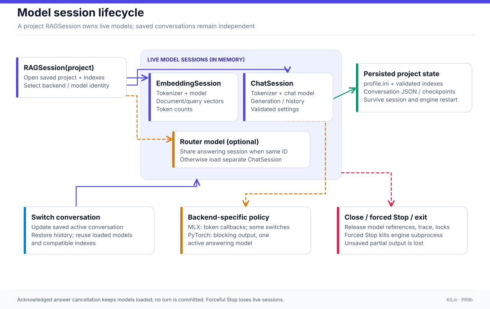

# Model backends, loading and session lifetimes

## Components and dependency boundaries

KíLín supports optional **MLX** and **PyTorch/Transformers** model sessions.
The common public interfaces are `ChatSession` and `EmbeddingSession`.
Neither is loaded merely by importing `kilin`; backend imports occur when
a session is instantiated. `kilin.runtime` resolves backend/device names,
`kilin.huggingface` inspects/downloads the model cache, and
`kilin.model_defaults` loads packaged starting model IDs. The optional GUI
presents suggested models through `gui/model_catalog.py`.

| Component | Responsibility |
| --- | --- |
| `runtime.choose_backend()` | Resolve `auto`, `mlx` or `torch` using operating system and architecture. |
| `runtime.torch_device()` | Select CUDA, then MPS, then CPU from caller-supplied availability flags. |
| `huggingface.available_models()` | Inventory model repositories and cached revisions (not runtime compatibility). |
| `huggingface.cached_model_snapshot()` | Resolve a usable local cached snapshot without downloading. |
| `huggingface.download_model()` | Explicitly fetch permitted model files, with progress integration. |
| `EmbeddingSession` | Load embedding tokenizer/model, count text tokens, create query/document vectors. |
| `ChatSession` | Load causal LM and tokenizer, format history, generate, retain/reset messages. |
| `RAGSession` | Own/reuse the chat, embedding and possible separate router sessions for one project. |

The locked dependency bounds and extras live in
[`pyproject.toml`](../pyproject.toml): Python `>=3.12,<3.13`, common NumPy/
PDF/Hugging Face dependencies, platform-conditional `mlx` and general
`torch` extras, and separate `gui` extras. Backend support is conditional on
working native packages and compatible model weights, not merely a matching
platform string.



*Figure: Live model sessions are distinct from persisted project state; backend policies and subprocess lifetime determine what can be reused.*

## Backend resolution

With `auto`, KíLín chooses MLX on native Darwin/arm64 and PyTorch otherwise.
An explicit MLX request outside that platform is rejected. MLX also checks
that Metal is available when loading the chat model. PyTorch probes device
availability and follows CUDA -> MPS -> CPU, then moves the loaded model to
that device and sets evaluation mode. These are selection rules, not claims
of deterministic output across hardware or backends.

**Backend policy belongs to the project profile** once a project has been
created. GUI launch arguments controlling dependency preparation do not
override the saved project's backend. `gui/model_settings.py` maintains
per-backend effort levels; PyTorch currently uses a single chat-model
session and does not implement MLX-style runtime effort-level model
switching in the answering path. Do not assume two model families offer
identical streaming or thinking controls.

## Model identity, caching and network behavior

A model identifier may denote an existing local directory or a Hugging Face
repository. Loading with `allow_download=False` resolves a local directory
or a complete cached snapshot; a missing/incomplete snapshot raises rather
than downloading it. With downloading allowed, backend loaders or an
explicit download command may access remote repositories. The cache
inventory alone does not prove that dependencies, architecture, quantization
or tokenizer are usable.

`ChatSession` passes `trust_remote_code=False` when loading tokenizers and
models via supported backends. This is a useful precaution, **not** a
security isolation guarantee. A model snapshot may still contain untrusted
or malformed files, and a user may explicitly choose paths outside the
standard cache. `revision` may be supplied to identify a model revision;
separate code in `retrievals/model_identity.py` records the identity of the
embedding model used when building an index. Avoid reusing vectors across
an unnoticed embedding-model change.

Model **IDs** in packaged `DEFAULT_MODELS` are recommended starting values,
not a frozen allowlist. See [Package defaults](package_defaults.md) for
exact default IDs and validation.

## Chat generation lifecycle

`ChatSession(model_id, *, backend, thinking, temperature, max_new_tokens,
system_prompt, allow_download, revision, trace, block_unrequested_cjk)`
constructs a model session and records its effective settings.
`configure_generation()` validates updates to `thinking`, `temperature` and
`max_new_tokens` before applying any values; unsupported fields are rejected.
Settings persist on the loaded session until changed.

`reply(message, *, max_new_tokens, trace_turn_id, token_callback,
language_context)` validates the request, renders the chat template, generates
an answer, and commits the messages only on success. Tracing records timing,
token statistics, and the requested/effective CJK token policy.

### Best-effort suppression of unsolicited CJK output

Suppression is enabled by default. It aims to prevent unsolicited Chinese,
Japanese, or Korean script in answers, not to prevent legitimate multilingual
requests. Only **original user messages** authorize output, by using script
characters or positively asking for them. Later explicit negative requests
or switches to English take precedence over earlier authorization. Ordinary
mentions such as "Explain Japanese culture" or "avoid Korean text" do not
authorize CJK output. Pinyin and romaji requests do not request Han or kana.
The detector is a deterministic heuristic for common English directives,
not a complete multilingual intent parser. The mask treats the supported
scripts as a group, not as independently enforceable language preferences.

For direct chat, `language_context=None` uses user-role history and the
current message, excluding system and assistant content. For constructed
prompts, supply the original user messages explicitly, in chronological
order, ending with the current question. An empty sequence grants no script
permission. RAG supplies selected earlier user questions and the original
current question, not evidence, resolved guidance, or generated wrappers.
Tool answer adapters do the same; internal side requests default to no
user authorization. No extra model call is made to decide this policy.

```python
answer = chat.reply(
    prompt_with_retrieved_material,
    language_context=(original_question,),
)
```

Tokens whose individual decoded text contains covered characters are
suppressed with an MLX logits processor or PyTorch `suppress_tokens`.
The cached scan runs once per loaded tokenizer on the first blocked reply.
It may add cold latency and does not cover characters assembled across
multiple byte-level tokens. A tokenizer without a usable vocabulary cannot
provide this suppression. This is **best-effort**, not an absolute guarantee
about generated language. Special tokens, general punctuation, and fullwidth
Latin letters are not suppressed.

The curated ranges follow Unicode 17.0's Han ideographs (including extensions
A-J and compatibility ideographs), kana and supplementary/halfwidth kana,
Hangul syllables and Jamo, Bopomofo, and CJK radicals. They are fixed code-point
ranges, including reserved positions within those ranges, not an exhaustive
Unicode script-property classifier. The reference block definitions are in
[Unicode 17.0 Blocks.txt](https://www.unicode.org/Public/17.0.0/ucd/Blocks.txt).

The input trace reports `cjk_blocking_requested`, `cjk_tokens_blocked`
(whether any standalone token IDs were selected), and
`cjk_suppressed_token_count`. These describe the mask, not proof that no CJK
character can appear. `ChatSession(block_unrequested_cjk=False)`, or
`block_unrequested_cjk = false` in a project's `[generation]` section,
disables suppression. Existing profiles retain explicit values; profiles
without the setting use the packaged default.

A tokenizer template, model context length, thinking tags, EOS behavior and
backend streaming granularity can vary across models. A `max_new_tokens`
cap truncates generation; it does not increase the model's context window.
`reset()` clears conversational messages while preserving the loaded model;
`restore_history()` replaces messages with validated records; `close()`
releases model/tokenizer references and requests backend cache cleanup.

**Streaming distinction:** MLX supports tokenwise incremental callbacks.
The current PyTorch path is blocking, so its first delivered text is not an
independent backend first-token timestamp. The GUI can further reveal a
completed answer over time as a presentation effect; do not treat that as
evidence of live model token generation. See [Performance](performance.md)
for which timings can actually be measured.

## Embeddings and retrieval

`EmbeddingSession` owns the embedding model and its tokenizer and provides
`count_tokens()`, `embed_documents()` and `embed_query()`. Document vectors
and query vectors must originate from compatible model identity/formatting.
The embedding API normalizes vectors and validates shapes. Retrieval uses
the vectors in its semantic channel; other channels (lexical/code) are
model-independent. Indexing uses the **embedding** tokenizer for chunk
boundaries; it does not necessarily match the chat model's tokens.

Embedding-query formatting is selected through `query_formats.py` and saved
in `profile.ini`. The `Qwen3` formatter does not imply all models require
the same prefix or instruction; changing format affects search quality and
may require controlled evaluation.

## Router and loaded-session reuse

`RAGSession` normally holds an answering chat session, embedding session and
possibly a separate router session. When `router_model` equals the
answering model ID, the same model session can be shared; separate IDs can
increase initial model-loading and memory costs. Router side calls are
kept distinct from committed chat history. `router_reply()` exposes a
controlled auxiliary model call (for example a conversation title).

Switching an active conversation keeps the project indexes and compatible
loaded sessions. Switching a chat model has backend-specific constraints;
`RAGSession.use_chat_model()` explicitly rejects unsupported switching
situations rather than promising transparent hot swapping. The GUI engine
remains the owner of its child process, and the Stop action unloads every
session in that process.

## Failure and cleanup

Missing model cache entries, unsupported native backends, incompatible
transformer files, tokenizer failures and out-of-memory errors may abort
construction or generation. `RAGSession` attempts to close partially
constructed models, owned trace logger and lock on failure. It attempts
all owned cleanup operations on normal close, even when one cleanup step
fails. A model close is not a guarantee that OS/GPU memory has immediately
returned to the same baseline.

Do not add silent downloads, unbounded retries or implicit model changes in
an effort to make errors disappear. Users must retain explicit control over
network access and model choice; see [Security](security.md).

## Validation and tests

Relevant suites cover `runtime`, `huggingface`, `chat`, `embeddings`, `rag`,
`model_defaults` and GUI model settings/catalogs. Test substitutes cannot
prove that native MLX and PyTorch models load or produce equivalent results.
Real model trials should record exact model revision, device, backend,
profile and tracing state. Performance and backend compatibility must be
confirmed separately on the target macOS/Python 3.12 environment.

Related: [Configuration](configuration.md),
[Retrieval pipeline](retrieval_pipeline.md),
[Answering pipeline](answering_pipeline.md),
[GUI architecture](gui_architecture.md).
