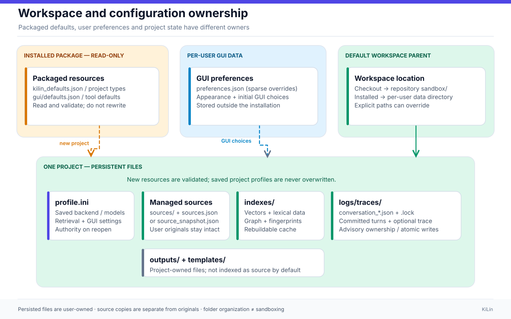

# Project workspaces and tool resources

KíLín creates and opens project workspaces through **core Python APIs**.
The GUI does not decide which folders or packaged tool resources a project
needs. This document describes the filesystem contract and how to extend it
without adding tool-specific conditions to project creation.

## Workspace structure



*Figure: Defaults, preferences, default workspace locations and persisted project state are intentionally different ownership layers.*

Every newly initialized project has the following core entries:

```text
project/
    profile.ini
    sources/
    indexes/
    logs/
    memory/
    outputs/
    templates/
```

The `templates/` and `memory/` directories **always exist**. The latter
owns user feedback about completed questions and answers; its files are not
ordinary project sources. Feedback JSON is created only on a user update.
See [Conversation memory](conversation_memory.md) for the ownership contract.
The templates folder also exists in projects that do
not currently use a templated tool. Users can add Markdown templates or
other resources manually. The `outputs/` directory is a general area for
project-owned results. Neither `outputs/` nor `templates/` is indexed as a
source directory by default. When a project's source is its own root
(`source = .`), KíLín's RAG scans explicitly exclude these managed
folders and the project-owned metadata files `profile.ini`, `sources.json`,
and `source_snapshot.json`; ordinary external source directories and files
with these names are not globally excluded.

### Source-directory convention

Every new project keeps its sources in `sources/`, whatever its project type
and however it is created: `initialize_project()`,
`prepare_project_workspace()`, and `prepare_sources_workspace()` all create
it. The name is the core constant
`kilin.workspace_resources.PROJECT_SOURCES_DIRECTORY`; it is not a setting.
Project types decide how sources are read, indexed, and answered, not the
folder name, so a project-type JSON file has no `source_directory` field and
one that still names it is rejected as an unknown setting.

Existing projects keep the `source` recorded in their `profile.ini`, for
example `documents/` or `repository/` from before this convention.
`open_project()` reads that path unchanged and performs no filesystem writes;
no folder is renamed or moved. A single-source mirror made before the
convention keeps its copy under the original's name, and
`synchronize_project_workspace()` updates it there.

### Selected sources and authorized reads

A project tool's source-data access is limited to files **selected into the
workspace**, not arbitrary files visible on the host filesystem. Imports
from external folders are explicit user operations; a name or relative
path written inside an imported document never authorizes another import.
The current source manifest records selected relative paths. The
project's configured source root determines where those names resolve,
while a shared tool-side check rejects paths outside the workspace and
symlinks. A selected file missing from its managed location is reported
unavailable, not substituted from the workspace root or original folder.

For example, `.bib` and `.bbl` are ordinary selectable literature sources:
they are copied, indexed, and searchable like `.tex`. A reference checker
may use their bibliography metadata only if those files were selected.
Selection from a folder uses the active project extension/profile policy;
users can control that selection before import. No LaTeX declaration
silently adds additional files. See [Security](security.md#workspace-source-access-policy)
for the limits of this application-level contract.

## Creation, opening, and explicit updates

**Creating a new project never reuses an existing project or a nonempty
folder.** This rule is enforced in the core, independently of the GUI.

| Operation | Contract |
| --- | --- |
| `kilin.initialize_project(path, type_id)` | Create in a nonexistent or empty directory, with an empty `sources/` folder. |
| `kilin.prepare_sources_workspace(...)` | Create a new managed `sources/` tree and record imports in `sources.json`. Never resume a saved workspace. |
| `kilin.open_project(path)` | Read and validate a saved profile and source path without changing files or creating missing folders. |
| `kilin.add_project_sources(path, source_paths, ...)` | Explicit cumulative import using the saved profile. Preserve existing snapshots unless `replace_existing=True` is requested. |
| `kilin.prepare_project_workspace(source, type_id, parent)` | Create a fresh single-source mirror in `sources/` and record `source_snapshot.json`. |
| `kilin.synchronize_project_workspace(source, path)` | Explicitly synchronize that saved mirror. May replace local snapshot edits or remove copies deleted from the original. |
| `kilin.project.configure_project(path, settings)` | Explicitly validate and update the saved profile. |
| `kilin.project.delete_project(path)` | Move a closed project into the `.deleted/` folder beside it, keeping its files. A name already there gets `_2`, `_3`, ... |

`configure_project` is exported by `kilin.project`, not by the top-level
`kilin` facade. In Python code, import it explicitly with
`from kilin.project import configure_project`. It updates the saved profile;
it does not reconfigure an already loaded `RAGSession` or rebuild indexes.

An explicit occupied project raises `kilin.ProjectAlreadyExistsError`, a
subclass of `kilin.WorkspaceOccupiedError`. Other nonempty destinations,
partial initialization, linked roots, and in-progress creation are rejected.
Even malformed `profile.ini` entries count as an existing project. Creating
inside another project's directory is also rejected. There is no creation
option that overrides these safeguards. A single-source mirror also rejects
source basenames that would alias managed state, such as `logs`, `indexes`,
`profile.ini`, or the creation marker. Import such folders with the cumulative
`sources/` API instead; their basenames are safe beneath that managed root.

For automatic workspace naming, omit `workspace_directory` and supply
`workspace_root`. With sources, the core derives a base name from the first
source's safe stem and eight-character path hash. Without sources, it uses
`new-project`. In either case, it then tries `-2`, `-3`, and subsequent free
names. Every existing entry is occupied, including empty folders and symbolic
links. Single-source mirrors use `project_<source-name>` and the same
numbered-sibling allocation. The final name is reserved exclusively;
`default_workspace_path()` merely suggests the base and is not a reservation.

```python
import kilin

first = kilin.prepare_sources_workspace(
    ["/path/to/source"], kilin.PROJECT_TYPE_IDS[0],
    workspace_root="/path/to/projects",
)
second = kilin.prepare_sources_workspace(
    ["/path/to/source"], kilin.PROJECT_TYPE_IDS[0],
    workspace_root="/path/to/projects",
)
assert first.root != second.root
```

Empty managed projects may use automatic naming or an explicit destination.
Both contain no placeholder sources or dummy indexes:

```python
project = kilin.prepare_sources_workspace(
    [], kilin.PROJECT_TYPE_IDS[0],
    workspace_root="/path/to/projects",
)
# For an explicitly chosen name, use the third positional argument instead:
# project = kilin.prepare_sources_workspace(
#     [], kilin.PROJECT_TYPE_IDS[0], "/path/to/new_workspace"
# )
project = kilin.add_project_sources(
    project.root, ["/path/to/notes.txt"]
)
```

Creation installs the normal profile, directories, and selected resources.
`sources.json` is written when sources are first imported. For each
copied file it records the copy's size and modification time at import
(`stamps`), so a later change to the original or to the copy can be told
apart; manifests written before stamps existed remain valid. Later imports
respect the saved profile and never modify it implicitly. Existing source
folders are copied into a new destination rather than adopted in place.
Previously saved root-as-source or external-source profiles remain readable;
opening them does not reinterpret their source layout. Model loading is a
separate session operation.

### Callers updating existing projects

Callers that use preparation as an implicit reopen must choose an
operation explicitly. Replace repeated cumulative preparation with
`add_project_sources(existing_path, sources)`, and repeated mirror preparation
with `synchronize_project_workspace(original, existing_path)`. Use
`open_project(existing_path)` for read-only opening. No compatibility switch
reintroduces implicit reuse. Existing project files and schemas need no
migration for this creation-safety change.

## Initial project creation

`kilin.project` calls `kilin.project_layout.plan_project_layout(type_id)` for
**new profiles**. The planner reads the validated `ProjectType` and
examines its intents. When an intent uses a registered tool, the tool may
provide an optional `workspace_resources(settings)` declaration. The settings
are those already validated by the project's tool registry.

`plan_project_layout` verifies that each declared file belongs to the
registered tool's package, validates its workspace-relative destination,
and deduplicates resources required by multiple intents. Conflicting destinations are rejected rather than
resolved by silent precedence. Planning does not write files.

For new projects, the core first validates the profile contents and resource
plan, creates required directories, installs **only the resources in the
plan**, and prepares the selected source snapshots and provenance. The
`profile.ini` file is then published atomically, without replacement, as the
final initialization step. No tool-specific resource selection occurs in the GUI.

The bundled types are Code Repository, Literature Collection, Writing,
Brainstorming (Creative) (`creative_brainstorming`), Brainstorming
(Grounded) (`grounded_brainstorming`), and Reviewing Assistant. The two
brainstorming types share the same source layout but differ in
whether ordinary ideation retrieves project evidence by default.

With the current bundled project types:

| Type | `templates/` contents after new project creation |
| --- | --- |
| `code` | Empty directory, ready for user templates |
| `literature` | `research_briefing.md`, `popular_science_summary.md`, `technical_summary.md`, `experimental_protocol.md`, `README.md` |
| `writing` | The same four templates and `README.md` |

These files are selected because the literature intents configure
`generate_paper_summary` with those template identifiers, and because the
`templated_report` intent (`template: "choose"`, in both types) uses any
template and installs every bundled one with `README.md`, the guide to the
format; the project initializer does not hard-code their names.

## Existing projects and user ownership

`kilin.open_project()` validates the existing profile and source path without
writing anything. It **does not reinstall templates or recreate folders**.
Calling a creation API on that directory raises an ownership error instead
of implicitly reopening it. As a result:

- Edits and new user-created templates remain untouched on reopening.
- Templates deliberately deleted by a user stay deleted.
- Missing folders remain missing on read-only opening. Explicitly call
  `kilin.project_layout.ensure_project_folders(root)` to restore empty core
  folders, and `install_project_resources()` to repair selected resources.
- Existing, unrelated template files are never removed simply because they
  are not mentioned by the current project type.
- A missing selected template causes the report tool to report an error
  rather than silently fall back to the globally shipped version.

An explicit, **opt-in** restoration is possible from the Python API:

```python
from kilin.project_layout import (
    install_project_resources,
    plan_project_layout,
)

install_project_resources(project.root, plan_project_layout(project.profile.type_id))
```

This installs only missing packaged resources; it never overwrites existing
files. Tool authors can offer more specific repair or reset commands later.

The core does not move or delete unrelated folders or generated files
implicitly. An existing `target/` directory is left untouched; `outputs/`
is created independently. No legacy migration is performed.

## `profile.ini` and the Settings panel

`profile.ini` is the project's authoritative settings layer (see
[Configuration](configuration.md)). It keeps every project setting from
the day the project was made, so a later KíLín release with new defaults
does not change an existing project. It can also be edited by hand while
the project is closed: reopening the project reads it again, an invalid
value stops the project from opening with a message naming it, and a
changed indexing value rebuilds the index.

| Section and keys | Settings place | Saved from the GUI |
| --- | --- | --- |
| `[project] type_id`, `source` | Chosen at creation | Never; `source` is always `sources` |
| `[project] extensions`, `max_file_bytes` | Project → Indexing | When entered and the user agrees to rebuild the index |
| `[chunking]` | Project → Indexing | When entered and the user agrees to rebuild the index |
| `[models] backend` | KíLín setup → Computation backend | At creation only |
| `[models] embedding_*`, `query_format` | Project → Models | When changed; a new embedding asks first and rebuilds the index |
| `[effort.mlx]`, `[effort.torch]` | Project → Models (effort levels) | When changed |
| `[router]` | Project → Models (intent model) | When changed |
| `[generation] temperature`, `max_new_tokens`, `thinking` | Project → Answers | When entered |
| `[search] depth` | Project → Answers (search depth) | When entered |
| `[tool.<name>]` | Project → Tools | When changed; only values that differ from the project type |
| `[models] allow_download` | None | Never; the GUI writes `False` so models are downloaded only from Settings |
| `[generation] block_unrequested_cjk` | None | Never; edit by hand to change |
| `[models] chat_mlx`, `chat_torch` | None | Kept equal to the Lagom (level 3) model; GUI answers use the chosen level's model on MLX |
| `[retrieval] count` | None | Never; GUI answers use the search depth step instead, so only the command line uses it |

Indexing edits made in the GUI are acknowledged only after the updated
project has reopened. The engine retains a complete snapshot of the
previous `profile.ini` and, if the operation fails after publication,
restores that text using atomic file replacement. A failure before the
profile changes leaves the existing session intact. If the engine already
started reopening the project, it restores the previous conversation after
the profile is recovered. If restoration or reactivation cannot be
verified, the project is left inactive and the user must inspect the
saved profile and reopen it (or restart KíLín if closing failed).

This is a **single-file profile rollback**, not a transaction over
`indexes/`, source manifests, and the index metadata. The core validates
saved index settings and source state on reopening and rebuilds stale
indexes as needed. A failed rebuild can therefore leave intermediate index
artifacts even when the previous profile has been restored.

The project's name is its folder's name, so it is not in `profile.ini`.
KíLín setup's Appearance and projects folder are per-user GUI preferences
in `preferences.json`, not project settings.

## Tool resource contract

An independently implemented tool may declare resources by adding an
optional callback to its `Tool` entry in `kilin.tools._registry`. The
callback accepts validated tool settings and returns a tuple of
`kilin.workspace_resources.WorkspaceResource` objects.

For example, the existing report tool declares a packaged file under
`kilin/tools/generate_paper_summary/templates/` and a destination under the project's
`templates/` folder. A custom template name that has no bundled file is
not declared as a packaged resource; its `templates/` folder is still
created, and the user can add the file manually before running the tool.
Declaring a resource does not copy it. The core
performs all installation.

A resource source must be a regular file inside the declaring tool's
package, not a symlink or a file owned by another tool. A declaration's
destination must be a safe, relative POSIX file path.
Absolute paths, traversal components, empty components, Windows drive
paths, and destinations inside source, index, log, or output areas are
rejected. The destination and its parents may not be symbolic links.
Existing files are preserved even during explicit resource restoration.

Every registered tool currently has its own validated `defaults.json`
and README. The `generate_paper_summary` package also owns its shipped
Markdown templates; other tools declare no workspace files at present.

## Explicit imports and source selection

Automatic directory scanning uses the project's configured extension list,
protected-filename rules, and maximum file size. Directly selected source
files may have other extensions or normally excluded names. The core copies
such files without changing `profile.ini`; the managed source manifest
records their explicit selection. The RAG source scan then includes those
regular, size-compliant snapshots even if the ordinary directory scan would
exclude them. Actual extraction may still fail for unsupported or binary
content, and such errors must be reported to the user.

When a source snapshot is deleted through
`kilin.remove_workspace_sources(project, paths)`, only files within a
managed `sources/` folder can be removed. Original source paths are not
modified, and `sources.json` is updated to reflect removed entries. Projects
with external or root-as-source locations cannot use that deletion API.
Index refreshing is a separate core operation.

`kilin.preview_project_sources(project, paths)` previews cumulative imports
without writing or reserving any files. It uses the core importer's
source-validation, file-size, directory-selection, and destination-naming
rules. Direct files of zero bytes or above the saved limit appear in the
excluded-file report; missing or linked paths fail validation. Same-name
sources in one batch receive the same distinct destination names the
importer would allocate. Preview is advisory: importing revalidates the
filesystem and project profile before copying.

`kilin.find_source_changes(project)` compares previously imported files with
originals using the saved metadata stamps. It also recursively scans tracked
source folders for **new eligible files**, including files in newly created
subfolders. It reports workspace-relative paths in four categories: `added`,
`changed`, `deleted`, and `edited`. Empty folders and folders with no eligible
files do not create additions. New-file discovery uses the saved project's
file-extension, protected-name, symlink, and file-size selection policies.

Matching size and nanosecond modification time are treated as unchanged; this
is a fast heuristic, not proof of identical contents. Previously tracked
paths that vanish are `deleted`, including files renamed or moved to another
path. Files at the new path may independently be reported as `added`; KíLín
does not infer a relocation or transfer tracking identity between paths.
Files without stamps, missing workspace copies, and symlinks are skipped.
Older pre-release manifests without copy stamps remain readable, but
their existing snapshots do not automatically acquire change tracking.
An original directory that is unavailable may look deleted, so a caller
should confirm bulk deletions. Unreadable source paths raise errors rather
than silently triggering deletion. Independently edited workspace copies
are classified as `edited` if the original changed or disappeared.

`kilin.sync_project_sources(project, decisions=...)` accepts individual
workspace-relative paths from that report. Permitted actions depend on the
change category:

| Category | Available actions | Default without `decisions` |
| --- | --- | --- |
| `added` | `import`, `keep` | `keep` (ignore new path) |
| `changed` | `replace`, `keep`, `keep_both` | `replace` for tracked files; `keep` for restored detached files |
| `deleted` | `delete`, `keep` | `delete` |
| `edited` | `keep`; also `replace` / `keep_both` when the original exists, or `delete` if it does not | `keep` |

When a `decisions` mapping is given, **unlisted files are untouched**. All
requested actions are validated before changes start. `keep` on a changed
original leaves the difference pending; `keep` on a deleted original detaches
the file from the original inventory while preserving the workspace copy.
If its original returns at the same path, the retained copy is reported
as `changed`, not `added`: the user can explicitly `replace` or
`keep_both` without overwriting it automatically. Until then, the
detached copy remains untouched, even by default synchronization.

`import` rejects unrelated collisions with workspace files. `replace` on
an edited copy is destructive and therefore requires an explicit per-file
action. Without `decisions`, the existing automatic replacement/deletion
behavior is preserved; new files are not automatically imported.

`keep_both` preserves the previous workspace copy under the reserved directory
`sources/.kilin_versions/<source-name>/...`, then updates the active copy
from the current original. Archived filenames have stable version-specific
paths and include a sequence number and a content digest. These historical
files are separately tracked in `sources.json` and explicitly selected for
**retrieval indexing as independent sources**. They keep their own source
paths in chunks, retrieval results, and citations. They are not overwritten
when the current source changes again, and removing the current copy does not
automatically delete its retained versions.

`kilin.list_source_versions(project)` lists these retained version paths
along with their original workspace paths and saved SHA-256 digests. A saved
version is omitted from that listing if the version file was removed or
replaced by a symbolic link. The reserved version directory is excluded from
ordinary scanning; only versions recorded in `sources.json` are explicitly
included. As with all other selected sources, **indexing still obeys the
saved file-size limits and supported extraction formats**. An oversized or
unsupported retained copy remains on disk but cannot be guaranteed to yield
searchable text. Indexing past versions in the same project may also introduce
conflicting evidence; their distinct citation paths identify the version.

If original metadata changes but the contents remain identical according to
SHA-256, synchronization updates filesystem metadata and the copy's stamp
without recopying bytes or creating a redundant version. Unchanged metadata
does not trigger a hash comparison. Synchronization refuses to replace
an existing copy with an empty or oversized original under the saved
project file-size limit, before changing any files. The saved limit also
applies when importing newly discovered files. Files are processed
independently: earlier successful operations can remain if a later
operation fails. A failed archive copy does not overwrite the active
source.

On project resume, the desktop engine runs change detection and offers
per-file choices when an original differs; dismissing the dialog leaves
copies unchanged. Synchronization is always a deliberate user action in
the GUI. The core `sync_project_sources` API does not refresh indexes:
after accepted changes, callers should invoke
`RAGSession.refresh_sources(project)` once, or reopen a RAG session to
trigger incremental indexing. The GUI refreshes once after applying a
batch. This API is specific to managed multi-source workspaces;
`kilin.synchronize_project_workspace()` is an older single-source
mirroring API with different semantics.

## Project-owned outputs and templates

The following GUI-independent core functions manage user-owned files:

- `kilin.add_project_files(project, folder, paths, replace=False)` copies
  selected local files or directories into `outputs/` or `templates/`.
  Naming collisions are given numerical suffixes unless replacement is
  explicitly requested.
- `kilin.replace_project_file(project, path, source)` replaces an existing
  regular file in one of those folders.
- `kilin.remove_project_files(project, paths)` removes files or directories
  inside **either** `outputs/` or `templates/`, but cannot remove the managed
  folders themselves.
- `kilin.list_project_files(project)` provides a filesystem inventory,
  including empty folders, without importing the GUI.

All paths are checked for containment and symlink traversal. These
operations do not require a model or reindexing, and the GUI only delegates
the file operations and reports their results.

## Failure behavior and limitations

An invalid profile or resource plan fails before reservation. The core uses
exclusive filesystem creation to claim a `.kilin-creating` marker and holds
it throughout initialization. Competing processes cannot initialize the same
workspace. An explicit destination is checked again after the marker is
claimed, not just before it. The running creator removes its marker on a
normal exit.

The profile is published **last** using a same-directory temporary file and
an exclusive hard link. Publication never replaces an existing profile,
including one that unexpectedly appears during initialization. Filesystems
that cannot provide this operation fail closed, without an overwrite fallback.
This is atomic visibility, not a guarantee against power loss.

On failure, the journal rolls back resources created by this attempt; it does
not recursively delete arbitrary contents. A pre-existing empty destination
is retained. A root created by this attempt is removed only if empty; shared
parent directories are not removed. Unexpected unrelated files are preserved.
A process termination may leave the marker and partial resources on disk.
Such a directory remains occupied and requires deliberate inspection/recovery;
creation never guesses that a marker is stale or silently clears the folder.
When the GUI stops its engine, it may remove an otherwise empty directory
containing only a marker matching that stopped engine's process ID and
recording that the attempt created the directory. Pre-existing empty folders
and legacy markers without this ownership information are retained. The GUI
never recursively deletes a project or its contents. A published project is
preserved even if the GUI has not yet processed its `opened` event. Incomplete
files may therefore require explicit inspection and removal by the user.

After a project is established, cumulative source additions and later source
synchronization are deliberately **not** all-or-nothing transactions.
Successful earlier imports remain when a later import fails, and provenance
is updated after each successful imported source. Removal likewise updates
provenance to reflect what remains after a partial failure.

Exclusive creation coordinates cooperating creators, not arbitrary hostile
processes that change files or links while an operation is running. Source
updates are not serialized by the creation marker. These APIs are not a
filesystem security sandbox. No model is loaded by initializing folders or
managing project-owned files.

The GUI reads the core file inventory. Empty directories are represented
with a trailing `/` rather than invented by the frontend.


## Change impact and verification

Creation, read-only opening, explicit updates and generated output publication
are distinct operations because they protect different user-owned state.
A layout change must account for both newly initialized projects and saved
profiles with older source locations; installing a new default is not an
implicit repair or migration.

Review `project._preparing_project`, `project_transaction.py`,
`project_layout.py`, `workspace_resources.py` and the affected `workspace.py`
operation together. Changes to sources must also update provenance, source
selection and [index refresh](retrieval_pipeline.md#incremental-updates).
Changes to outputs/templates must preserve their non-source status and
[tool output publication](tool_packages.md#generated-output-safety).

Exercise [creation](../tests/kilin/test_project__creation.py),
[reservation and rollback](../tests/kilin/test__project_transactions.py),
[resource planning](../tests/kilin/test_project_layout.py),
[source management](../tests/kilin/test_workspace__source_management.py),
[synchronization](../tests/kilin/test_workspace__source_changes.py) and
[user files](../tests/kilin/test_project_files.py). Check the
[GUI creation adapter](../tests/kilin/gui/test_engine__creation.py) as well;
Qt-free tests cannot prove native file-dialog or filesystem-platform behavior.

## Related

[Configuration](configuration.md), [Source pipeline](source_pipeline.md),
[Tool packages](tool_packages.md), [Conversation ownership](conversation_ownership.md),
[Security](security.md).
