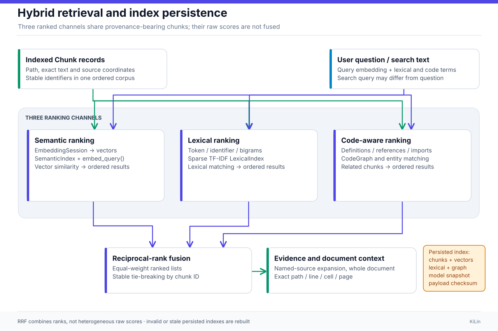

# Retrieval and index architecture

## Responsibilities and public interfaces

KíLín separates **source processing** from **retrieval**. The former yields
provenance-bearing `Chunk` records; the latter produces several rankings,
combines them and expands evidence for explicit code or document references.
The main orchestration belongs to `kilin.rag.RAGSession` and the algorithms
live under `kilin/retrievals/`.



*Figure: The three passage-ranking channels of `hybrid` preserve different signals; reciprocal-rank fusion combines their ranks, and persisted indexes must pass integrity and model-identity validation.*

`kilin.retrievals.__init__` exposes the supported records and functions;
private helpers and individual extension internals should not be treated as
stable public interfaces. The three hybrid-ranking channels can operate over the
**same ordered chunks** but employ different scores and heuristics.

## Semantic channel

`EmbeddingSession` loads the configured embedding model and tokenizer, then
exposes `count_tokens()`, `embed_documents()` and `embed_query()`; token and
vector behavior is backend-specific. `build_semantic_index()` couples
retrieval chunks with document embeddings. `semantic_search()` embeds a query
and ranks candidates using the stored numerical vectors. The implementation
validates embedding shape, cardinality and finite numeric values; persistent
semantic content must match the referenced chunk order.

Embedding-query formatting is not universal. `query_formats.py` defines
`plain` and Qwen3-compatible modes, while the project's `profile.ini` stores
the configured query format. Do not conflate display text, retrieval query
text, model-specific embedding query format and the original user question.
The Qwen3 query formatter is applied by the relevant semantic-search path,
not by modifying original source files.

Indexed text is not always the displayed passage. A Python or MATLAB code
passage is embedded and lexically indexed with its file path in front and,
for Python, the first line of its module docstring (`_retrieval_text` in
`rag.py`), so a function can be found by what its module is about even when
its own name and code use other words. Evidence, citations and the answering
model keep the passage text itself. The format is recorded in the index
settings (`retrieval_text`); changing it rebuilds saved indexes.

In project types with the `document_headers` capability (the packaged
`literature` type), each document passage is indexed after a short header:
the document's title, its first author and file name, and the section
heading and page it comes from
(`retrievals/document_headers.py`). Titles and first authors come from
PDF metadata when plausible, from the first `#`
heading of a Markdown file, or else from the file name; section headings
are recognized by name ("Methods", "Data availability") or numbering
("3.1. Software architecture"). A methods paragraph is then found for a
question about its paper even when it never repeats the paper's name. The
header format is recorded in the index settings (`document_headers`).

## Lexical channel

`retrieval_lexical.py` tokenizes text into lowercase words, source-oriented
identifier components and adjacent bigrams. It builds a normalized sparse
TF-IDF representation using term counts and inverse document frequency.
`lexical_search()` computes its channel-specific rank. The tokenizer is
ASCII-oriented and does **not** perform stemming or general multilingual
linguistic analysis. A lexical score should never be compared directly to a
semantic score as though they represented the same scale.

## Code-aware channel

`code_graph/code_graph.py` represents code entities/relations and constructs
an indexed graph from source units. The Python extension uses AST-oriented
heuristics for definitions, references and imports; the MATLAB extension
uses text patterns. These are useful structured hints, **not complete
semantic call graphs** and not a code execution or static type checker.

`retrieval_code.py` resolves likely code entities in a question and finds
related chunks. The channel runs only when the question names a file,
function, or class (`names_code` in `context_expansion.py`). For ordinary
prose, it would match common words to identifiers and introduce noise.
Graph structure and chunk provenance must agree: a stale graph can misdirect
named-function context even when semantic vectors remain readable.

Expansion also follows retrieved documentation, module headers, and test
calls to implementing functions. Exact qualified names and uniquely resolved
suffixes are preferred. An unresolved qualified name can still suggest a
unique leaf-name alternative. Supported matches consume the documentation
bridge budget first; ambiguous leaf names are not guessed. Alternatives
remain labeled as such rather than being asserted to identify the named code.

Related functions compete for `RETRIEVAL.RELATED_PASSAGES_MAX` passages,
using the **same validated cosine scores** already computed by semantic
search. Non-unit embeddings retain the ordinary cosine contract. No extra
query embedding, vector conversion, or rescoring is performed for expansion.
The current loop backend already sorts all chunks; RAG retains that ranking
and slices each channel's intended depth before fusion, so reuse does not
silently deepen the fused semantic channel. Scores live only for one query.

Explicit files and named functions are included in full. Every direct
neighbor requested by a relationship question contributes context outside
the shared passage budget, but each long related function is still limited
to `RELATED_CHUNKS_MAX` chunks (currently two). Those chunks prioritize call
sites and question terms. Zero means unlimited for either passage cap;
these settings are not a promise that every related function is included
in full. Alternatives follow supported related passages in the shared budget.

For source-preferring intents, each channel ranks `SOURCE_SEARCH_DEPTH`
times the retrieval count. Its best source-code results retain their order,
followed by its overall best `SOURCE_SEARCH_OTHERS`, before fusion.
`SOURCE_SEARCH_RESULTS` fused results are kept, or the retrieval count when
larger. Documentation and tests count as wanted results when asked for.
Tutorials and tests can otherwise outrank the implementing code merely
because they use a question's words more often.

### Requested targets and broader evidence

A named-file scope is a **focus**, not a hard exclusion of other files.
The requested file's best passages seed retrieval; expansion can still find
helpers, tests, documentation, and plausible alternatives elsewhere. The
full semantic ranking is reused when ranking a focused file, preserving
passages outside the original top results without another embedding call.

Final RAG evidence prioritizes requested targets, retains the existing
ordering within each relevance group, and labels `context_role` as `direct`,
`related`, or `alternative`. Direct targets win over other labels. The prompt
instructs the model to attribute alternatives to their actual paths and
symbols, not to equate differently qualified names without evidence. The
optional label is persisted with evidence and included in traces; older
records without it load as unclassified (`None`). When evidence is reused
from an earlier turn, its old direct-target label becomes related; an
alternative warning is retained. Source text is unchanged.

## Hybrid combination: ranks rather than scores

`retrieval_hybrid.hybrid_search()` takes ordered semantic, lexical and code
channel results. It performs **reciprocal-rank fusion (RRF)**: for each
channel, a chunk's contribution is `1 / (rank_constant + rank)` using a
one-based rank. Each channel has equal weight and raw channel scores are
discarded; repeated chunk identifiers inside one channel contribute only
once. The combined results are sorted by descending fused score, then
stable chunk identifier for ties. `RETRIEVAL.RRF_RANK_CONSTANT` is the
packaged default smoothing constant. Per-query retrieval count limits the
ranked output; explicit context expansion may yield more evidence.

This has two implications for developers: (1) changing the relative channel
scales does not directly influence fusion, but changing **order** does;
(2) an optimization must preserve the content and ordering of evidence,
not just the number of embeddings or the final answer string.

## Generic source-card contracts

The `retrievals/source_cards/` package defines reusable **source-card
records** used by the active source-card index. A
`SourceDescriptor` describes a selected file by its relative path, known
title, suffix and existing chunk identifiers, including files without
extractable text. A file extension **does not classify its content**: a PDF
is not necessarily a scientific paper, and a chunkless image need not have
a card.

A `SourceCard` contains the source path, registered card-kind ID, schema and
validation versions, source SHA-256, optional model/generation fingerprints,
kind-specific metadata and substantive `CardStatement` records. Statements
refer to original chunk identifiers rather than PDF-only page coordinates.
Generic validation checks source ownership, nonempty fields, duplicate
references and that citations resolve to chunks permitted for card creation.
A kind-specific validator remains responsible for content rules; citations
establish traceability, **not proof of semantic support**. Only original
source chunks can provide final answer evidence.

`SourceCardResult` separately represents `valid`, `not_applicable` and
`failed` outcomes. The `SourceCardRegistry` stores trusted Python kind
implementations and rejects unknown/duplicate IDs or obsolete versions.
A kind's deterministic `precheck` may rule out clearly ineligible sources;
positive results are only candidates, with full eligibility deferred to the
kind's generation/verification logic. Project JSON never imports kind code.

The generic contracts, independent index, dedicated generation adapter,
scientific-paper kind and indexing coordinator are implemented. The
packaged literature intents use four-channel `source_first` retrieval.
No migration layer for the removed paper-card cache is provided.

### Independent source-card index

`retrievals/source_cards/index.py` stores `IndexedSourceCard` outcomes by
`(source_path, card_kind)` and prepared `SourceCardVector` groups in separate
containers. A valid card must pass the registered kind's schema checks and
original-chunk provenance validation before admission with
`prepare_source_card_index()`. Cached `not_applicable` and `failed` outcomes
record source SHA-256 and schema/validation versions, so they need not be
regenerated on every indexing attempt. Failed attempts can be retried on a
change of generation model/settings or by explicit request; changing the
model does not invalidate complete valid cards. Missing and stale records
are identified by `plan_source_card_updates()`, which does not call a model.

`retrievals/source_cards/persistence.py` uses **two separate atomic files**:

- `indexes/source_cards.json` holds content, chunk references and outcomes.
- `indexes/source_card_vectors.json` holds vector groups and the resolved
  embedding model identity, without duplicating card content.

Each file has a distinct format identifier and canonical SHA-256 payload
checksum. Every vector group is also tied to the digest of its corresponding
card and the exact ordered search texts from its card kind. An embedding
model or text-projection change invalidates only the affected vectors; an
unrelated card update does not force all vectors to be regenerated. Missing
vector files are normal. After a partial two-file update, loading the vector
file drops outdated groups individually, while retaining matching groups.
Corrupt or unsupported files raise `ValueError` instead of silently loading
bad data. Atomic writes protect each individual file, not the pair as a
transaction; concurrent writers still need higher-level coordination.

`search_source_cards()` performs standalone cosine search over already
prepared vectors. A caller supplies a query embedding; it does not construct
one, start a model, or add card text to the evidence presented to an answer.
The default `source_first` strategy incorporates the card-vector search
as a fourth source-ranking channel. The persistence format does not
read the older `paper_cards.json` file.

### Dedicated generation adapter

`source_cards/generation.py` provides `SourceCardGenerator`, an optional
model-inference adapter independent of the active RAG answering and routing
sessions. The model and inference parameters come from core-owned
`[source_card_generation]` settings (see `model_management.md`). The
model is loaded only on the first requested card and is released at the
end of the generation batch. It uses the established validated completion
contract; prompt selection and scientific content rules belong to the
registered `scientific_paper` kind. The adapter validates the configured
input budget; the kind enforces it when composing prompts.

Literature projects generate missing or stale selected cards on opening
or refreshing, when the saved indexing policy permits. No generation model is
loaded when the current cards are reusable, and retrieval itself never
runs card generation.

### Scientific-paper cards

`source_cards/kinds/scientific_paper.py` implements the first trusted kind,
`scientific_paper` (schema version 1, validation version 1). It retains the
original paper-card summary fields: `abstract`, `aim`, `methods`, `data`,
`findings`, and `limitations`. Bibliographic metadata additionally records
`title`, `authors`, `year`, `venue`, and `identifiers` when available. Each
nonempty substantive statement must cite original chunk IDs; the generated
card is never direct evidence for an answer.

The kind covers research articles, preprints, reviews, conference papers,
methods papers and scientific-software papers. File extensions alone do not
establish eligibility. A deterministic precheck rejects sources with no
extracted chunks or usable text. For the remaining candidates, **one**
dedicated-model call jointly decides applicability and produces the card.
An explicit non-paper verdict yields `not_applicable`; malformed, ambiguous,
truncated or unsupported responses yield `failed`, not a speculative card.
No separate eligibility or provenance model call is made. Non-paper sources
remain available through ordinary retrieval.

Passage selection takes the first three chunks in reading order and up to
two lexical matches per methods/data/findings/limitations query. The entire system and user prompt, including labels,
source metadata and excerpt text, is bounded by the configured estimated
input-token limit. The first excerpt can be clipped while retaining its
chunk identifier. Passages are encoded as quoted untrusted data; instructions
embedded inside them have no authority. Field citations use numbered prompt
excerpts and are converted to existing chunk IDs. Invalid citation groups
cause their field to be omitted; at least one supported substantive field
is required. Presence of a chunk reference does **not** prove that the
statement is semantically entailed by that chunk.

The indexing coordinator invokes this generator when scientific-paper
cards need to be built; generated text never replaces source passages as
answer evidence.
The registry and generic persistence also allow future, independently
validated kinds for grant proposals, patents, CVs, slide decks, technical
manuals, policy documents, and other sources when needed. These kinds
are **not** implemented or inferred from file extensions.

## Automatic source-card indexing

Literature projects enable the `scientific_paper` card kind by default.
After normal extraction, chunking and semantic/lexical/graph indexing,
`RAGSession` calls `reconcile_source_cards()` in
`retrievals/source_cards/indexing.py` on both project opening and
`refresh_sources()`. The coordinator checks source hashes, card-kind schema
and validation versions, and existing records before calling the separate
Qwen3-8B generation model. It generates only missing or outdated cards,
then embeds only missing or stale card search texts with the current
embedding session. The card-generation session is released before loading
the interactive answering model on initial project opening. A failed or
ineligible card does not prevent normal passage search.

There are **two independent derived cache files** under `indexes/`:
`source_cards.json` for validated content, outcomes and source identities,
and `source_card_vectors.json` for per-card embedding groups. Card content
is saved before vectors; interrupted writes and corrupt derived caches
can be recovered incrementally. Unchanged valid cards survive a change of
generation model, while vector groups are rebuilt if the embedding model
or search-text projection changes. A failed generation attempt can be
retried on a source, schema, model or generation-settings change;
a cached `not_applicable` result is reused until its source or kind
validation changes. The prerelease implementation does not migrate or read
`paper_cards.json`; the inactive standalone implementation has been
removed and its relevant tests cover the new source-card pipeline.

Project-type `capabilities.source_cards` defines default `enabled`, `kind`
and `automatic` values. Project-level overrides are saved in
`[source_cards]` of `profile.ini`, independently of generation-model
settings. Source-specific overrides use case-sensitive, source-relative
paths in `source_card_sources.json`. The master `enabled` switch disables
the card channel, even when a source override requests a card. Individual
sources can opt out or select another registered kind; the selected kind
must still pass content eligibility. With `automatic = false`, valid cached
cards can be searched, but missing and outdated cards are not generated.
See [Configuration](configuration.md#source-card-indexing-policy).

For each valid `scientific_paper` card, the kind projects three search
texts (abstract/aim, methods/data, findings/limitations), retaining
the three-group representation used by document retrieval. The default
`source_first` strategy uses these vectors as one source-ranking channel.
Card text is never answer evidence: answers cite original source chunks.

Explicit requests for all sources ("all five papers", "each study",
"across the articles") are recognized independently of source ranking
by `retrievals/source_coverage.py`. Such requests activate exhaustive
coverage for source-first answers; simply mentioning "two papers" does
not request the entire collection. A paper named in a question is
searched, not appended in full: code-oriented full-file expansion
applies only to code files.

A file is named in a question (`named_paths` in
`retrievals/document_reading.py`) by its path, its file name, a stem that
looks like a file name (with a digit, `_`, `-` or `.`, as in `smith2020`),
a stem in backticks, or an author-year citation. A plain-word stem counts
only when followed by a noun for that kind of file: a document noun for
documents ("the hinton paper", "the architecture document"), "notebook" for
notebooks, "module" or "script" for other files ("the chat module"). "File"
is not enough: "the configuration file" in a question, or in text pasted
into it, does not name `configuration.md`, and "the config file" does not
name `config.py`. A named file limits the search to that file, so a weak
match would silently leave the rest of the project out.

Which document a follow-up means (`document_scope` in
`tools/_shared/choose_document.py`) is decided by its wording when that is
clear: words for one document ("its limitations", "that study") keep the
document the earlier turns were about, and words for several ("these
articles", "the other papers", "all") search the whole project. The router
model judges only the remaining requests.

A document can also be described instead of named ("the 2017 paper", "the
BRAPH 2 paper", "the earlier BRAPH framework"). `retrievals/
source_descriptions.py` matches such a description against the source
cards: a year against the card's year (or, when the card has none, the
year an author-year file name starts with), and every other word against
the card's title; "earlier" or "original" (and "later" or "newer") pick
the oldest (or newest) of the papers that fit. A description resolves only
when exactly one paper fits; a paper with no known year fits any year, so
it keeps a year description ambiguous. A resolved description limits the
search as a named file does; with "it" in the question ("compare it with
the 2017 paper") the earlier turns' document is kept too.

## Four-channel source-first retrieval and evidence budgets

`retrievals/strategies/retrieval_sources.py` ranks sources independently
from complete semantic, lexical, applicable code-graph and source-card
rankings. Each available channel contributes one reciprocal-rank score per
source; repeated chunks or card kinds do not inflate a source's rank.
A card-ranked source need not have any globally top-ranked passage to
be selected. All answer evidence still comes from the original chunks,
not from generated card statements.

Fusion gives every source a position in every channel, so in a small
project every source is ranked, however unrelated, and a position says
nothing about how relevant a source is. Before sources are chosen,
`relevant_sources` therefore keeps only those the question is about: a
source the question names, a source with a passage among the first
*count* passages of the fused passage ranking (*count* is the intent's
evidence count), and the source whose card ranks first. A comparison
keeps at least two sources, and a question naming a number of sources
("review the five articles", `requested_source_count`) at least that many
(the next ranked ones when fewer qualify).
Exhaustive questions ("all five papers") and several named sources skip
this cut. The trace event `retrieval.sources.ranked` lists the sources
left out as `unrelated`.

`retrievals/evidence_budget.py` adds validated per-intent **hard evidence
limits** for source-first retrieval. Each selected source receives one
original passage where it fits. The strategy then approaches the optional
per-source target and fills remaining capacity from relevant original
passages. A configured source quota is a target, not permission to exceed
any hard passage or estimated-token limit. The budgeter preserves entire
chunks and their line ranges; it skips oversized chunks rather than
silently shortening evidence. Each token estimate includes the actual
citation header, source-relative path and provenance label, and follows
`document_reading.estimate_tokens` (one token per four characters, rounded
up). This **is not** exact tokenizer or total conversation accounting.

### Per-intent source-first configuration

Add these fields to an ordinary model-answering intent's `retrieval` object
in `kilin/project_types/<type>.json`. Each field is validated during
project-type loading. The intent is selected by routing, or by the default
intent when routing is disabled. Configured budgets are not overridden by
the project's ordinary `retrieval_count` (which remains relevant to other
strategies).

| Setting | Allowed values | Behavior |
| --- | --- | --- |
| `strategy` | `"source_first"` | Source-level four-channel RRF followed by original evidence. |
| `max_sources` | Integer 1–50 | Upper bound on represented sources; default 3. |
| `passages_per_source` | Integer 1–10 | Target per selected source; default 1. |
| `max_passages` | Integer 1–200 | Final hard number of original evidence passages; default 8. |
| `evidence_tokens` | Integer 1000–200000 | Final hard estimate of evidence tokens, including source headers; default 5000. |
| `coverage` | `"bounded"` or `"exhaustive"` | Coverage policy; default `"bounded"`. |
| `include_related_evidence` | Boolean | Earlier cited passages compete for the **same** limits. |

For example, literature comparisons have the following settings:

```json
{
  "mode": "search",
  "strategy": "source_first",
  "max_sources": 8,
  "passages_per_source": 2,
  "max_passages": 16,
  "evidence_tokens": 9000,
  "coverage": "bounded",
  "include_related_evidence": true
}
```

The three built-in literature model-answering intents use:

| Intent | Sources | Target per source | Hard passages | Evidence tokens |
| --- | ---: | ---: | ---: | ---: |
| `question_answering` | 3 | 1 | 8 | 5000 |
| `compare_sources` | 8 | 2 | 16 | 9000 |
| `report_generation` | 8 | 1 | 12 | 8000 |

These are **packaged project-type defaults**, not universal limits on
project size, the number of indexed sources, or standalone tools.

### Coverage meaning and failure behavior

`bounded` selects the most relevant source set within configured limits.
It **does not** claim every source was checked. `exhaustive` attempts to
represent every requested source with at least one original passage.
Questions explicitly asking about *all*, *each*, or *every* source request
exhaustive mode for that turn, regardless of the configured bounded default.
When a request names several documents, the explicit scope is strict.

If not every requested source can be represented, KíLín appends a
deterministic **Coverage incomplete** notice to the answer, without another
model call. It identifies how many requested sources had at least one
passage and notes unindexed sources separately. The saved turn parameters
contain a `coverage` record (requested/represented counts, missing paths,
limit reasons, estimated evidence tokens and `complete`), and the trace
receives `retrieval.coverage`. This report expresses **source representation
in the supplied context, not an exhaustive reading of each document**.
No additional model calls or background batches are started.

The final limiter runs after context expansion **and** related-turn evidence
have been considered. Expansion and follow-ups cannot bypass the passage,
source or estimated evidence-token caps. Citation numbers are rebuilt from
the retained passages. Large contexts can still exceed the full model's
available context because chat history, system instructions and the question
are outside these *evidence* limits.

Tools selected by `tool` replace this ordinary retrieval path. A tool
continues to own its own validated `part_tokens`, batch and model-call
limits, configured in that tool's `defaults.json`, the project-type
intent's `tool` object, or saved `[tool.<name>]` overrides (where exposed).
The reusable `EvidenceLimits`/`allocate_evidence` helper permits future
tools to adopt equivalent evidence budgeting, but existing tools do not
silently inherit these new source-first values. Registered tools can
use `ToolContext.retrieve()` without changing `ToolContext.rank()`.

The supported answering retrieval strategies are `hybrid` and
`source_first`. Literature project defaults use `source_first`.

## Named-document retrieval and full-document reading

There are several distinct retrieval modes determined by the selected
`ProjectType.Intent`:

| Mode | Meaning |
| --- | --- |
| `search` | Search the indexed corpus with the configured strategy and count. |
| `document` | Identify and read a named or contextually selected whole document, fitted to a token budget. |
| `reuse` | Reuse evidence from related earlier turns without a new general search. |
| `none` | Generate or otherwise handle a request without retrieval. |

See the canonical values in `project_type.py`. The `document` path uses
`retrievals/document_reading.py`: `named_paths()`, `dominant_path()`,
`read_document()` and `DocumentSelection` distinguish explicit names from
search-ranked document selection, then fit content into a budget. Tools also
use shared document resolution under `tools/_shared/choose_document.py`.
A document-scoped request may require ranking enough material **inside that
document**, even if global top-k omitted its relevant passages; therefore
simply deleting an additional ranking query can be a correctness regression.

`retrievals/context_expansion.py` separately expands evidence near named source
references using `ContextExpansionPlan` and the graph. This expansion is not the
same as model-based intent routing in `answering.py`; the latter decides
which **operation** to perform, not which chunk matches a function name.

## Index persistence and identity

`PersistentIndexes` stores aligned semantic and lexical data plus a
`CodeGraph`, source fingerprint and embedding-model identity. The persisted
JSON includes chunks, vectors, lexical statistics, code relations and a
payload SHA-256 checksum. `save_indexes()` uses atomic single-file
replacement. `load_indexes()` validates the serialized structure, vector
cardinality/finite values, lexical vocabulary consistency, identifier
uniqueness, content fingerprint and full payload checksum.

Two checks address different failure modes:

- **Source fingerprint / `indexes_are_current()`:** does this bundle represent
  the current ordered chunks and code graph?
- **Payload checksum / identity:** were the serialized vectors, statistics
  and model reference preserved as expected? A matching checksum is an
  integrity check, **not an authenticity or tamper-proof security scheme**.

Backend/library versions are not all encoded in the index identity. A source
snapshot alone does not guarantee semantic compatibility after changing
models or indexing parameters. Older index formats without recorded model
snapshot identity can require a full rebuild.

### Incremental updates

`RAGSession` can reuse cached embeddings for unchanged chunks when a saved
index and the current embedding-model snapshot and chunking configuration
allow it. Changed/new chunks are embedded; removed entries disappear from
the new index. The lexical index and global code graph are rebuilt for the
complete updated corpus. If cache validation fails, rebuilding is safer than
mixing vectors from different settings.

A model ID string is not necessarily sufficient to identify the actual
cached weights. `retrievals/model_identity.py` resolves embedding-model
identity as used by cache validation. For downloads and explicit local
snapshots see [Model management](model_management.md).

### Projects without indexed passages

A project with no selected sources, or no extractable chunks, has index
status `empty`. RAG keeps an empty retrieval container and the current
source inventory in memory; it does not persist a dummy index or call the
query embedder. Previously saved caches are not served as evidence in this
state. Adding sources invokes normal indexing on refresh. Existing model
loading and the selected type's prompt/tool policies are unchanged.

## Retrieval versus generation

`RAGSession.ask()` maps retrieved chunks or selected documents to `Evidence`
records with source location and exact text. These are inputs to the
answer-generation prompt or a registered tool. It may append evidence cited
by related prior turns as configured. Retrieval **does not guarantee** that
the model uses, cites or correctly interprets its evidence; KíLín performs a
fast deterministic check for citation identifiers that do not correspond to
available evidence. [Answering](answering_pipeline.md#citation-checks-and-answer-truthfulness)
owns that diagnostic and its limitations.

No universal evidence-token budget guarantees every retrieval result fits
in a model's context. Full-document reading has its own configured budget.
The index is a convenience for local content discovery; it does not assert
that an answer is scientifically valid.

## Tracing and performance analysis

The RAG and retrieval paths emit timed spans/events for preparation,
retrieval and generation; trace details can be expensive and sensitive.
[Performance](performance.md) analyzes existing diagnostic traces without
changing retrieval. Further optimization requires reproducible measurements
and evidence-order invariance checks, not only fewer model calls.

Progress wording describes actual work, not project IDs. Relationship
search is announced only when the graph has entities, with actual result
counts; otherwise the message explicitly reports that it was skipped.

## Change impact and verification

Rank fusion deliberately compares channel order rather than incompatible
raw score scales. A change to indexing text, tokenizer, embedding identity,
context expansion or rank depth can therefore alter evidence without changing
the final answer API. Review persistence identity, RAG orchestration and
evidence labels alongside the specific ranking algorithm.

Run [retrieval algorithms and persistence](../tests/kilin/retrievals/),
[index provenance](../tests/kilin/test_rag__index_provenance.py),
[retrieval corrections](../tests/kilin/test_rag__retrieval_corrections.py)
and [empty workspaces](../tests/kilin/test_rag__empty_workspace.py).
Check stable source coordinates, tie ordering, direct/related/alternative
labels, old-cache rejection and explicit failure cases. A deterministic
unit substitute validates structure, not live embedding quality; evaluate
ranking quality separately before claiming a retrieval improvement.

## Tool-owned bounded retrieval

The core `RetrievalRequest` and `RetrievalResult` records in
`retrievals/requests.py` provide an explicit, model-free retrieval boundary
for registered tools. `ToolContext.retrieve(request)` delegates to the same
`RAGSession._retrieve()` path used by ordinary answering. The request owns
its strategy (`hybrid` or `source_first`), `EvidenceLimits`, optional
source-relative scope, comparison behavior, and optional registered
source-card-kind filter. The result returns original indexed `Chunk` objects
in citation order, the source-ranked candidates, and a deterministic coverage
report. A selected source may not have a passage that fits the token budget;
selection is **not** evidence that it supports the user's question.

Tools must opt in; `ToolContext.rank(query)` still returns a complete hybrid
ranking without source cards or hard evidence limits. Exhaustive scanners
continue using full rankings or original chunks. `retrieve()` never inherits
ordinary answering-intent limits: tools must declare their own budgets in
validated tool settings. The hard limits cover selected original passages,
source headers and estimated evidence tokens, not model output, full chat
history, or the complete source contents. Unknown card kinds are rejected,
and card-kind filtering applies only to source-first discovery.

See [Tool retrieval and settings](tool_packages.md#tool-retrieval-and-settings)
and [suggest_reference](../kilin/tools/suggest_reference/README.md) for the
first opt-in consumer.

### Regeneration and memory-safe refresh

`RAGSession.refresh_source_cards()` reconciles only the derived card and
embedding caches. `RAGSession.regenerate_source_cards()` explicitly forces
new card-generation attempts but leaves extracted chunks and semantic,
lexical and graph indexes unchanged. Both honor the saved project-wide card
policy and per-source overrides. Model parameters and source eligibility are
validated by the core, independently of the GUI.

During initial project opening, card generation precedes interactive model
loading. On refresh, the core checks for pending generation before releasing
interactive resources. If new cards are needed, it saves the answering
history, generation settings, and token totals; releases the answering
and any separately loaded router model; generates cards with the dedicated
model; then restores the answering session. A warm refresh requiring no
cards does not reload interactive models. Failure to restore the answering
model closes the session explicitly, requiring the project to be reopened.

## Related

[Source pipeline](source_pipeline.md),
[Answering pipeline](answering_pipeline.md),
[Package defaults](package_defaults.md), [Model management](model_management.md).
