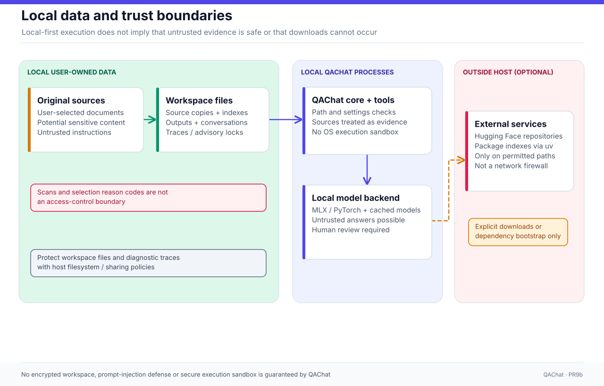

# Privacy, trust boundaries and failure limitations

## Threat model and explicit non-goals

*Figure: A local-first application still processes untrusted evidence and may contact external services through explicitly allowed operations.*

KíLín is designed for **locally controlled knowledge work**. Projects,
indexes, source snapshots, generated outputs and conversations can be kept
under the user's filesystem control and inference can use local models.
These features are valuable, but they are **not** equivalent to a secure
sandbox, authenticated multi-user service, encryption system or adversarial
prompt-injection defense. This document states implemented boundaries and
where users or deployers remain responsible for security.

| Boundary | What KíLín does | What it does not guarantee |
| --- | --- | --- |
| Local source selection | Applies scan exclusions, size limits, path containment checks and explicit import rules. | Comprehensive secret detection; race-free protection against filesystem changes. |
| Project workspaces | Keeps managed copies, outputs, templates and indexes organized; validates path destinations for managed operations. | OS process/filesystem isolation or safe execution of arbitrary untrusted code. |
| Model use | Supports local model cache, explicit `allow_download=False` and backend choices; configures `trust_remote_code=False`. | That dependency installation or optional model downloads are offline; that model files are harmless or answers correct. |
| Conversations | Uses advisory locks and atomic single-file replacement. | Encryption, tamper resistance against an uncooperative process, cross-file transactions or secure erase. |
| GUI | Loads local HTML/JS, disables remote-local-content access in its Qt view, and inserts answer text without evaluating arbitrary HTML. | Strong isolation from all hostile local programs or malicious instructions embedded in viewed documents. |
| Tools | Selects from registered built-ins with validated settings and scoped context. | A general permission/policy sandbox or arbitrary external plugin containment. |

## Sensitive data paths

The original sources, copied `sources/` tree, `sources.json` provenance,
`source_snapshot.json` manifest, `indexes/` vectors and cached exact text,
`logs/traces/conversation_*.json`, archived/deleted conversations,
`outputs/`, `templates/`, user preferences and model caches can each expose
private information. Embeddings are **derived from** sensitive text and
should not automatically be treated as anonymous. Tool outputs and generated
PDFs may include quotations or confidential synthesis from indexed content.

An **enabled diagnostic trace** is particularly sensitive. It can record
full prompts, source excerpts, model output, token identifiers, errors and
tracebacks; a trace export should not be represented as privacy-safe. A
trace-disabled session still persists completed conversation checkpoints,
which may themselves contain question, answer and evidence text. See
[Trace recording](trace_recording.md) and
[Conversation ownership](conversation_ownership.md).

KíLín does not provide a general automatic secret scrubber, encrypted
workspace format, backup retention policy or secure deletion mechanism.
Access control, disk encryption, user separation, backups and permissions
are deployment responsibilities. Files under ignored local `sandbox/` are
not automatically safe to share; Git ignores and clean ZIP exports merely
reduce accidental packaging.

## Original files and managed snapshots

Automatic directory scans exclude common secrets, metadata and binary model
weights. The exclusion lists are not exhaustive, and **explicit file
selection can override some directory-scan exclusions**, including certain
protected-looking filenames. That capability may be necessary for legitimate
research, but it makes informed user consent essential. The structured
`reason_code` field identifies why a scanner entry was skipped; it is
not an access-control token and cannot make a forbidden symlink safe.

Imported sources are copied to managed workspaces. Deleting a managed source
snapshot does not delete the original. `project_files.py` validates that
edits occur inside `outputs/`/`templates/` and rejects symlink/path
traversal under its declared contract. `WorkspaceResource` validation
prevents built-in tools from silently installing a packaged file outside
safe destinations. None of these checks fully prevents concurrent local
filesystem modification by another process.

New-project reservation protects existing and partially created destinations
from cooperating creators; stale markers require deliberate recovery. The
[creation failure contract](project_workspaces.md#failure-behavior-and-limitations)
owns that procedure. It is not protection against arbitrary hostile
filesystem mutation, and it does not serialize later source updates.

## External access and third-party components

Running KíLín locally does not imply every action is offline:

- `kilin --gui` may invoke `uv sync` to prepare missing optional
  dependencies; dependency resolution can contact package registries.
- Model downloads and backend loaders may contact Hugging Face repositories
  when permitted. `allow_download=False` prevents model download through the
  supported local-only loader path, but is not a general network firewall.
- Users may explicitly open output files with native desktop applications
  whose subsequent behavior is outside KíLín's control.
- Optional tool/model dependencies or OS libraries may have their own
  telemetry, cache locations, permissions and vulnerabilities.

For a constrained offline workflow, preinstall known dependencies, cache
verified compatible model revisions, choose `allow_download=False`, and
launch without automatic synchronization (see
[GUI README](../kilin/gui/README.md)). Network isolation, when required,
should additionally be enforced by the host OS/environment.

## Model content and prompt injection

Documents and code repositories can contain instructions addressed to an
LLM. Retrieval supplies those bytes as **evidence**, not authoritative
system policy. A model might still follow malicious instructions in an
untrusted source, cite a passage incorrectly, hallucinate or produce unsafe
code. Numeric citation checking establishes only that cited indices exist,
not that the answer is supported or correct. Human review is still required
for scientific conclusions, software changes and high-impact decisions.

Tools are explicitly registered, and `ToolContext` limits how models
interact with KíLín operations. This is good architectural containment but
not a comprehensive prompt-injection mitigation or command-execution sandbox.
There is no general agentic OS-shell execution boundary documented as
implemented in this repository snapshot.

## Persistence, concurrency and failure

[Conversation ownership](conversation_ownership.md) specifies canonical paths,
companion-file advisory locking and atomic single-file writes. These guards
coordinate participating writers; they do not stop a program that ignores
them, create a transaction across indexes/manifests/traces or guarantee
power-loss durability. A persistent `.lock` file alone is not an active
lease, and removing an active companion can break coordination.

Unexpected failure can leave previously completed source operations in
place. GUI Stop is likewise not rollback of earlier filesystem work or a
way to resume interrupted generation. The
[Stop protocol](gui_protocol.md#errors-stop-and-restart) distinguishes
cooperative cancellation from forced process replacement; the
[answer lifecycle](answering_pipeline.md#persistence-and-exactly-one-committed-turn)
distinguishes displayed partial output from a checkpointed result.

## Safe deployment and review checklist

1. Keep private workspaces and conversation traces out of public archives.
   Treat exported notebooks, CSVs and figures as potentially sensitive too.
2. Restrict model downloads and dependency installation explicitly when
   offline or reproducibility is essential.
3. Review source selections, especially individual files whose names would
   normally be excluded from automatic directory scanning.
4. Do not use scanned/indexed source content as trusted instructions or
   assume successful citation checks establish factual correctness.
5. Validate all user-supplied paths, tool settings, model IDs and packaged
   resources at their owning subsystem; avoid reimplementing policy in the
   frontend.
6. Run tests for malicious path forms, symbolic links, concurrent writers,
   malformed state/trace files, failed writes and cleanup.
7. Isolate Qt/WebEngine integration tests from test processes that construct
   other Qt application types. Run native tests on supported hosts.

Any plan to support hostile multi-user input, executable agents, remote
services or stronger isolation requires a separate threat model and a
separately approved design. Do not market workspace organization as a
security guarantee.

### Change impact and verification

A new external action, executable capability or writable location changes the
trust boundary, even when the UI calls it a convenience. Identify the actor,
input, destination and failure residue first; review the owning subsystem's
validation instead of inventing parallel GUI policy. Stronger guarantees
require an explicit design, not stronger wording in this reference.

Start with [workspace transactions](../tests/kilin/test__project_transactions.py),
[resource containment](../tests/kilin/test_workspace_resources.py),
[atomic writes](../tests/kilin/test_atomic_writes.py),
[conversation ownership](../tests/kilin/test_conversation_ownership.py) and
[safe generated outputs](../tests/kilin/tools/_shared/test_outputs.py).
These are concrete boundary regressions, not a comprehensive security audit.

## Related

[Project workspaces](project_workspaces.md),
[Source pipeline](source_pipeline.md),
[Model management](model_management.md),
[Trace recording](trace_recording.md),
[Development](development.md).
