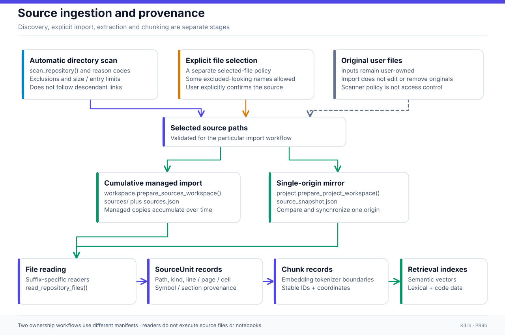

# Source selection, import, extraction and chunking

## Scope and owners

Source ingestion converts **local files chosen by the user** into text units
with traceable origin, then token-bounded chunks for retrieval. The four
operations should not be mistaken for one transaction:

*Figure: Source selection, the two managed-import APIs, format-specific extraction and chunk identity are distinct; original source files remain unchanged.*

| Step | Owner / main API | Output |
| --- | --- | --- |
| Preview policy | `repository.scan_repository()` | Scan report with entries, selected files, skip codes |
| Snapshot / source management | Create through preparation APIs; update through explicit import/synchronization APIs | Managed copies and source manifest |
| File content | `sources.read_repository_files()` | `SourceFile` records |
| Natural units | `sources.extract_source_units()` | `SourceUnit` records |
| Chunking | `chunking.chunk_source_units()` | `Chunk` records with stable identifiers |
| Change comparison | `repository.build_repository_manifest()`, `compare_repository_manifests()` | Added, removed, modified content state |

The complete workspace ownership model, including which APIs create
`sources.json` or `source_snapshot.json`, is documented in
[Project workspaces](project_workspaces.md).

## 1. Selecting sources is policy, not reading

`scan_repository(repository, *, extensions, include_paths, exclude_paths,
max_file_bytes, max_entries)` walks a resolved local root using `os.scandir`.
It rejects remote-looking addresses, invalid size limits, a home/root scan,
and malformed relative include/exclude paths. Directories are inspected
without following descendant symlinks/junctions. Entries are sorted for a
stable report; a scan can report `complete=False` when a non-root directory
could not be inspected. Exceeding `max_entries` raises rather than returning
a falsely complete inventory.

The report contains the resolved repository root, normalized suffixes,
include/exclude paths, byte/entry totals, `selected_files`, and entry rows.
Each row has `path`, `status`, a human-readable `reason`, and a stable
`reason_code`. The codes are defined in
[`repository_reason_codes.json`](../kilin/repository_reason_codes.json),
validated once by `repository_reason_codes.py`, and transmitted to the
frontend in its settings event. The only special GUI opt-in is a file skipped
for `file_too_large`; protected or linked files do not become selectable
merely because a display message changes. See [GUI protocol](gui_protocol.md).

Scanning **does not establish an access-control boundary**. Between a
filesystem check and subsequent opening another process may change a path.
The directory scanner's exclusions are project/source-selection defaults,
not a guarantee that every secret has been identified. Especially important:
**direct file selection has a separate rule from automatic directory scans**.
An explicitly imported regular file may have an excluded-looking name or
extension. The managed source manifest records the selection, and
`workspace.include_explicit_imports()` keeps eligible snapshots in the RAG
index scope; unsupported content can still fail extraction. Do not add a
security prohibition to the GUI by reinterpreting a scanner explanation.

Packaged `REPOSITORY` exclusions and default suffixes are documented in
[Package defaults](package_defaults.md). A project type and saved profile
also set selection rules; see [Configuration](configuration.md).

## 2. Snapshot and provenance alternatives

Source processing can read managed copies from two distinct workflows:

| Workflow | Creation API and provenance | Explicit update path |
| --- | --- | --- |
| Cumulative imports | `prepare_sources_workspace()`; `sources.json` records imported copies. | `add_project_sources()`, managed removal and `sync_project_sources()`. |
| Single-source mirror | `prepare_project_workspace()`; `source_snapshot.json` records the mirror. | `synchronize_project_workspace()`. |

Their replacement/deletion semantics are not interchangeable. The complete
[workspace contract](project_workspaces.md#explicit-imports-and-source-selection)
owns those semantics, collision handling, original-file protection and
partial-failure behavior. Source readers should consume the resulting
validated selection, not perform another implicit import or synchronization.

An empty newly created managed workspace is valid. It uses the same
[core source-directory convention](project_workspaces.md#source-directory-convention)
as a populated project; no example corpus is invented. Creation eligibility
and later import APIs are documented with
[workspace creation](project_workspaces.md#creation-opening-and-explicit-updates).
Opening a saved profile retains its source path. Outputs/templates are
separately managed user files, not automatically added to source indexing.

After explicit source changes, the GUI asks the core to refresh indexes.
Imports and indexing are not a single multi-file transaction: successful
copies can remain when a later import or index refresh fails. Do not infer
that a valid source manifest proves a completed retrieval rebuild.

The optional source-card channel runs *after* ordinary chunk, semantic,
lexical and graph indexing. It selects eligible documents, reuses cached
cards and embeds missing summaries without replacing original passage
evidence. See [Automatic source-card indexing](retrieval_pipeline.md#automatic-source-card-indexing).

## 3. Reading files and retaining source coordinates

`read_repository_files(report)` consumes the report's `selected_files` in
order. It resolves each selected path again, rejects traversal, links,
non-files and paths escaping the selected root, then uses a suffix-specific
reader if one exists. Other inputs are decoded as UTF-8. Binary content is
not automatically made readable by giving it a textual suffix. A PDF uses
its dedicated selectable-text reader and may require installed PDF
extraction dependencies. A Word `.docx` file is read with `python-docx`
into Markdown-style text: headings become `#` lines, numbered or bulleted
items become indented `-` lines, and each table row becomes one line of
cells separated by ` | `. Indented paragraphs without numbering are not
turned into list items. An old binary
Word `.doc` file is read with `olefile`: the body text, paragraphs and
table rows are kept the same way, but headings are not recognized. Word
files are recognized by their first bytes, so a `.doc` renamed to `.docx`
(or the reverse) is still read by the right reader.

`SourceFile` contains a relative path and extracted text; `SourceUnit`
contains a path, text, inclusive line range, kind, optional symbol/section,
optional notebook cell, and optional child units. The `extract_source_units`
entry point chooses format-specific parsing and validates unit provenance.
It does **not execute source files or notebook cells**.

| Extension module | Implemented structural unit strategy |
| --- | --- |
| `sources_py.py` | Python AST declaration boundaries and subordinate regions |
| `sources_m.py` | MATLAB declaration/section patterns in text |
| `sources_md.py` | ATX Markdown headings and sections |
| `sources_ipynb.py` | Notebook JSON, code/Markdown cell text and cell coordinates |
| `sources_pdf.py` | Page-oriented selectable PDF text; page/section coordinates |
| `sources_docx.py` | Word body text in reading order; Markdown heading sections |
| `sources_doc.py` | Old Word 97-2003 body text in reading order; no headings |
| `sources_html.py` | HTML page text with heading sections; as code, source markup split at main HTML elements |
| `sources_js.py` | JavaScript line-leading functions, classes, and direct methods; lexical masking and balanced braces prevent spurious declarations and scope crossings |
| `sources_r.py` | R top-level functions, classes, and S4 methods, with attached comment blocks and class-method children |
| `sources_json.py` | JSON preserved as written; top-level object keys become child units for large files |
| `sources_tex.py` | LaTeX front matter and sections at `\part` to `\subsubsection`; setup before `\begin{document}` left out |
| `sources_bib.py` | BibTeX entries and macros as independently indexed units with citation keys |
| `sources_bbl.py` | Compiled LaTeX `\bibitem` references with original line and key provenance |
| `sources_txt.py` | Nonblank paragraph text units |

JavaScript extraction uses lexical masking within `sources_js.py` to keep
comments, strings, template literals, and likely regex literals out of
structural matching. It preserves source offsets and balances braces to
separate declarations from unrelated statements. This is a conservative
heuristic, not an ECMAScript parser: inline/mixed-line declarations,
dynamic code, and executable template interpolations are not fully
analyzed. Unrecognized text remains searchable as source context.

R extraction similarly preserves the original source text and line
provenance. Top-level `r_function`, `r_class`, and `r_method` units include
their associated comments. A comment-only line between a function's
parameter list and its opening brace does not terminate the function.
Other statements remain in `r_script` units. R readers use structural
heuristics rather than executing R or building a complete syntax tree.

JSON extraction retains the original file text and line coordinates.
Large top-level objects can be divided into child units at their
keys, while arrays and single-line objects remain whole. The reader
is a structural scan, not JSON validation; malformed JSON can still
be searched. Projects selecting `.json` record `json_source_units`
(`top-level-keys-v1`) in index metadata. Existing JSON indexes without
this version are rebuilt once to replace obsolete chunk boundaries.
Profiles not selecting `.json` retain their previous index identity.

Word title and author properties are read separately for literature
search headers and the paper-summary tool. The property reader handles OLE
(`.doc`) and OOXML (`.docx`) containers based on their signatures, returning
missing metadata on unreadable documents. It does not invent bibliographic
information or change the stored-file size policy. The stable
`tests/kilin/sources/extensions/fixtures/sample.docx` fixture was converted
from `sample.doc` with LibreOffice and has explicit title/author properties;
it complements generated tests for specific Word list styles.

**HTML as text or as code.** A project reads its files as code when its
type's `code_graph` capability is `true`, as for Code projects;
`"auto"` and `false` read them as text. HTML is the one format read
differently: as text, `read_source_file` keeps what a reader sees, with
headings, lists and tables, and leaves out scripts, styles and tags, like
a Word file; as code, `read_repository_files(..., as_code=True)` keeps the
file as written and `extract_source_units(..., as_code=True)` uses the
reader's `extract_code_units`. Citation line numbers refer to the text
that was indexed, so the reference preview reads the file the same way.
The index records `html_as_code` for projects that select `.html`, and
HTML cached as code has a separate identity from HTML cached as page text;
other file types keep their existing cache identities. In a Code project,
a page imports its local scripts and follows leading direct calls from
inline `on...` handlers. The graph reader ignores HTML comments, inert
templates, and JavaScript string contents. HTML read as page text does not
contribute code-graph relationships, even when it contains examples of
markup. JavaScript functions and methods link their plain calls.

Literature profiles now allow `.bib` and `.bbl` alongside `.tex`.
Selected bibliography files are ordinary indexed sources, not hidden
auxiliary resources: a BibTeX entry and a compiled `\bibitem` can each
be searched with its original source provenance. The lightweight
extractors do not compile LaTeX or prove that a cited paper supports a
scientific claim. Bibliographic declarations in a `.tex` document are
resolved by `reference_check` only against files explicitly included
in the workspace source inventory. See the
[workspace source-access policy](security.md#workspace-source-access-policy).

The implementation uses the actual suffix-to-reader dispatch in
`sources/sources.py` and its `extensions/` directory. An unsupported suffix
may be decoded as text, but it is not thereby semantically parsed. PDF image
OCR, exhaustive language parsers and executing notebooks are **not**
implicit features of this pipeline.

**Coordinate conventions:** `Chunk.start_line`/`end_line` are one-based
inclusive and refer to the source unit's coordinate system, not necessarily
a single physical file-wide line number. Notebook positions are cell-local;
PDF text is page-local with section provenance. Word (`.docx` and `.doc`)
line numbers refer to the extracted Markdown-style text, not to Word
pages. Citations and source previews must preserve these distinctions.
Altering a reader's coordinate convention is a compatibility-sensitive
change; update tests and evidence consumers.

## 4. Chunk boundaries and identifiers

`chunk_source_units(units, *, count_tokens, target_tokens, max_tokens,
overlap_tokens)` uses the **selected embedding tokenizer** to estimate
length, not a universal character-to-token conversion. It honors natural
units where possible, subdivides oversized units, and can overlap adjacent
chunks according to the validated parameters. `max_tokens >= target_tokens`
and `0 <= overlap_tokens < target_tokens` are required. A callback reporting
a negative or non-integer count raises a validation error.

A `Chunk` preserves `identifier`, relative `path`, exact fragment `text`,
start/end line, `kind`, `symbol`, `section`, and `cell`. The identifier is
content/location-derived using an unambiguous JSON-array encoding. A change
in the identifier algorithm is an index-format compatibility change: old
indexes may need rebuilding. The generic `CHUNKING` default arguments are
**different** from `PROJECT_PROFILE` values persisted in newly created
projects; the active RAG pipeline passes its project's saved values.

## 5. Refreshing sources and avoiding unnecessary embeddings

A repository manifest records selected file fingerprints for change
comparison. After a source update, `RAGSession.refresh_sources(project)`
connects the new inventory to extraction, chunking and index reuse. Changes
to a reader's text or coordinates can change chunk identity even when the
original file is unchanged, so reader changes need cache/evidence tests too.

The [incremental-index contract](retrieval_pipeline.md#incremental-updates)
owns reuse eligibility, model identity, full-rebuild fallback and which
indexes are rebuilt. Source manifest equality is not index-payload integrity;
`retrievals.persistence` validates that separate boundary. A refresh should
not silently reuse vectors merely because a path or model ID looks familiar.

## Errors, boundaries and validation

- Failures to list or read a selected root, inconsistent scan reports,
  relative path traversal, or invalid source records propagate as explicit
  errors; callers must not treat a partial scan as a complete deletion list.
- File selection is a usability and privacy precaution, not a robust
  race-free isolation boundary or a comprehensive secret scanner.
- Explicit user import does not make an unreadable format extractable.
- Workspace deletion must be confined to managed source snapshots. Source
  originals should never be deleted by cleanup or reindexing operations.
- Changing extraction or chunk identity affects cache reuse, evidence
  coordinates and citation reproducibility; test these together.

## Change impact and verification

Selection, decoding and structural extraction are separate so a policy change
does not silently become a content transformation. When adding a reader,
follow the [extension checklist](extension_interfaces.md#source-readerextractor-contract)
and preserve exact text, stable ordering and the declared coordinate system.
Changes to unit boundaries or chunk IDs require review of cache reuse,
code graphs and citation previews together.

Run [scanner tests](../tests/kilin/test_repository__scan.py),
[source reader tests](../tests/kilin/sources/),
[chunking](../tests/kilin/test_chunking.py),
[index provenance](../tests/kilin/test_rag__index_provenance.py) and
[reference previews](../tests/kilin/gui/test_engine__references.py).
The [source-selection suite](../tests/kilin/gui/test__source_selection.py)
checks reason-code independence from human-readable wording. Real malformed
PDFs and optional readers may require additional format-specific fixtures;
no reader should execute notebook or source code to obtain text.

## Related

[Project workspaces](project_workspaces.md),
[Retrieval pipeline](retrieval_pipeline.md),
[GUI protocol](gui_protocol.md), [Security](security.md).
